# Primary COP / dominance-enhanced MWIS results

Generated by `results/5_csp_mwis_comparison_plots_primary.py`, a separate copy of
the validated loading/reconstruction logic in `5_csp_mwis_comparison_plots.py`.
Only `mwis-dominance-enhanced` is used for MWIS. COP is read directly from the
final tracked archive `results/runs/csp_final.zip`, without requiring extraction;
the figure legend follows the report's COP terminology. No experiment, solver,
annealing sampler, source notebook or global configuration is executed or edited.

## Endpoint and reference separation

The **primary result** is the selected schedule reconstructed before MILP/LP
reference solving. It includes sampled terminals, exact fixed choices, separator
assignments and greedy incomplete leaves. It contains no MILP-generated contact.
The primary schedules are independently recovered from saved tree metadata and
selected samples, and validated against the original candidate table, satellite
exclusivity, antenna setup and objective totals. Removed dominated alternatives
are not restored. Primary terminal retention is measured before MILP replacement.

All 14 primary records are feasible. 3/14 reach their certified
reference optimum. Primary objectives match the producer's classical tree
reference in 13/14 records; that tree reference is not the global optimum
when incomplete leaves remain. The lone mismatch is MWIS at 50/350 (0.205 below
the producer reference). Sampling is classical simulated annealing, not quantum
hardware. Provenance describes retained contacts, not causal advantage or CPU work.

Reference upper bounds are independently checked against the saved feasible,
certified postprocessed schedules. Since these bounds are tight for this campaign,
the primary gaps are retrospective distances to the certified optimum. The saved
MILP evaluation solves incomplete reduced components, not the entire original
instance as a standalone MILP benchmark. Its schedules, improvements and
certificates are separate in `reference_evaluation_metrics.csv`; they are not the
main result and are not inserted into primary Gantt or gateway plots.

## Five report figures and quality table

- `00_primary_quality_table`: seven distinct configurations; baseline counted once.
- `01_primary_quality_scaling`: satellite and gateway quality, two panels.
- `02_primary_schedule_provenance`: paired primary contact shares, one panel.
- `03_terminal_profile_tradeoff`: primary quality and total reads, two panels.
- `04_baseline_logical_dimensions`: baseline scatter, one column.
- `05_producer_stage_profile`: logged producer stage shares, one panel.

For separate experiment subsections, use the full-width standalone panels:
- `01a_primary_quality_satellite_scaling` and `01b_primary_quality_gateway_scaling`.
- `03a_terminal_profile_primary_quality` and `03b_terminal_profile_sampling_workload`.
- `S01a`/`S01b`: retained terminal fraction and incomplete leaves.
- `S02a`/`S02b`: average logical variables and average nonzero couplers.
- `S03a`/`S03b`: contacts after dominance and largest reduced component.
- `S04a`/`S04b`: leaf-size distributions for baseline and 500/50.

These 12 figures redraw the same data on separate 179 mm canvases, with their
own axes, legend (where needed) and captions. The combined figures remain
available; do not include both versions of the same plot in the report.

For the two-column main report, three additional `_column` exports redraw
`01a`, `01b` and `03a` on 86 mm canvases, with readable fonts, compact titles
and shorter axis labels. Use these PDFs with `figure` and `width=\columnwidth`.
The existing full-width variants remain available. Figure 04 is already
column-sized; figure 02 remains full-width. The gap axis in the compact figures
uses the same certified reference optimum as the full-width versions.
`primary_quality_table.tex` is an editable Overleaf table fragment matching
the image table. It uses `booktabs` and `table*` for a two-column report; use
`table` for a single-column document. Prefer this native table in the report.

Full-width figures use 179 mm canvases; figure 04 and the three `_column`
exports use 86 mm canvases. PDFs preserve
vector lines/text with embedded TrueType fonts; PNGs are 300 DPI. Include them at
their documented width rather than shrinking an old dashboard. `figure_layouts.json`
records exact sizes and panel counts. No figure contains more than two plots.
Captions provide scope and limitations; titles are kept short for printed size.

`S01`-`S04` are supplementary workload, mean dimensions, shared component structure
and two-case leaf-distribution views. Operational plots show ranked gateway
**excerpts** (15 in Gantt, 20 in activity by default), using primary contacts and
the same ranking for both methods. Full schedules and all gateways, including
unused ones, remain in `schedule_metrics.csv` and `gateway_metrics.csv`.

## Timing interpretation

Both final campaigns use 500 reads per terminal. The final CSP archive replaces
the earlier 1,000-read CSP runs and supplies updated timings, including 100/50.
Objectives and selected-contact provenance are independently checked against
the team's updated comparison. Earlier report drafts describing unequal read
budgets need revision. These remain single matched runs on different computers.

Figure 05 uses shares of four disjoint logged **producer** phases, not a total
primary-pipeline runtime. It excludes unprofiled overhead and all later notebook
work. Classical producer evaluation includes exact terminal reference evaluation
and incomplete-leaf evaluation, and is distinguished from sampling.

`timing_records.csv` keeps full recorded workflow time, producer clocks, MILP/LP
solver-call time, and the later notebook remainder separately. Subtracting solver
time alone does not isolate main reconstruction: reference graph preparation,
validation/export and reconstruction share saved timing blocks. Therefore
`isolated_primary_pipeline_seconds` remains unavailable, rather than estimated.
MWIS also has a separately logged sampling/decoding/CSV-export code-cell time;
this is not a pure sampler-call time, and a corresponding COP clock is unavailable.
No missing value is substituted with zero.

Recorded timings are descriptive: hardware/environment provenance was not matched,
although both methods now use 500 reads per terminal. Total reads
include discarded alternative branches. Leaf counts are recorded tree workloads,
not repeated-run uncertainty. Active resource identities are not fully nested in
scaling scenarios; only terminal sensitivity uses the identical input throughout.

## Regeneration and audit

From the repository root in the project Python 3.13.14 environment:

```powershell
python -B -X utf8 results/5_csp_mwis_comparison_plots_primary.py
```

The default folder is `results/figures/csp_mwis_primary`. Options are `--output-dir`,
`--schedule-scenarios baseline` (or several keys, default all), `--gantt-gateways`
and `--activity-gateways`. Only a directory belonging to this primary analysis can
be regenerated. Existing other comparison folders and source run folders are protected.
`--source-git-ref COMMIT` reads the final CSP archive and comparison reference
directly from that commit when working with an older checkout; no extracted CSP
directory is changed. Archive members use `archive.zip!member` manifest keys.

Every source actually used is hash-checked before completion. Source selection,
copied-script provenance, software versions, preservation checks and validation
are in `source_manifest.json`, `preserved_artifacts_manifest.json` and
`validation_report.json`. `comparison_metrics.csv` uses explicit primary/reference
field names. `primary_quality_summary.csv` is the compact report table;
`terminal_metrics.csv` distinguishes primary and postprocessed retention.

## Figure captions


### 00_primary_quality_table

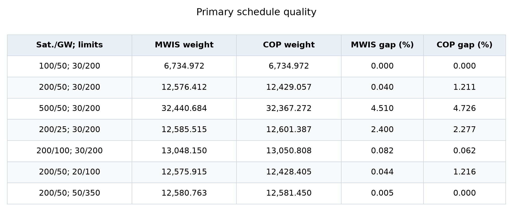

Primary reconstructed schedule weights, before MILP/LP reference evaluation. Limits are logical variables/couplers. Gaps are retrospective distances to certified reference optima; all primary schedules are feasible. The shared baseline is listed once. Full-precision values and reference optima are in primary_quality_summary.csv.

[Vector PDF](00_primary_quality_table.pdf)

### 01_primary_quality_scaling

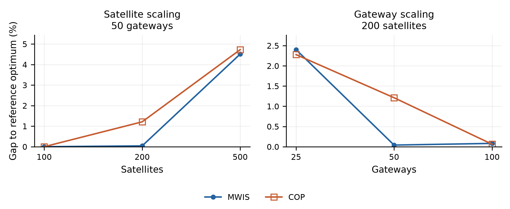

Primary schedule gaps to certified reference optima, excluding MILP-generated contacts. Left: satellite scaling; right: gateway scaling. The baseline is reused. Active resource identities are not fully nested, so differences describe the selected scenarios rather than a strictly isolated resource-count effect. Both methods use the same candidate CSV within each pair.

[Vector PDF](01_primary_quality_scaling.pdf)

### 02_primary_schedule_provenance

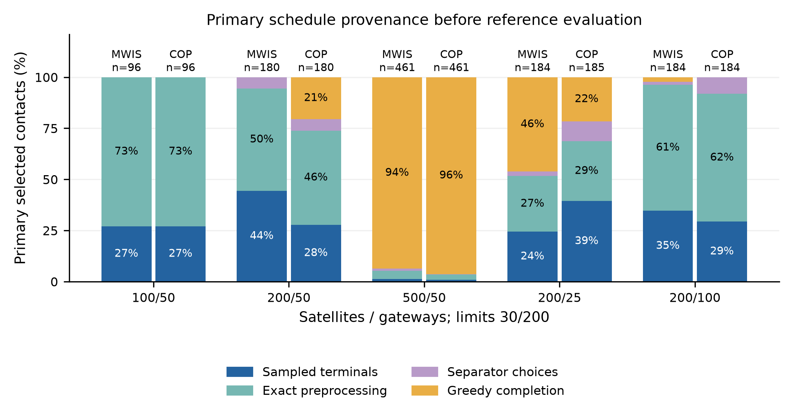

Origins of contacts retained in the selected pre-MILP reconstruction, with paired MWIS/COP bars for the five distinct datasets. n is each primary schedule's contact count. MILP is not a category. These are contact shares, not objective shares, execution time or a causal measure of sampling advantage. Sampled alternative branches discarded by reconstruction do not contribute. All seven profiles' contact and weight provenance are in comparison_metrics.csv.

[Vector PDF](02_primary_schedule_provenance.pdf)

### 03_terminal_profile_tradeoff

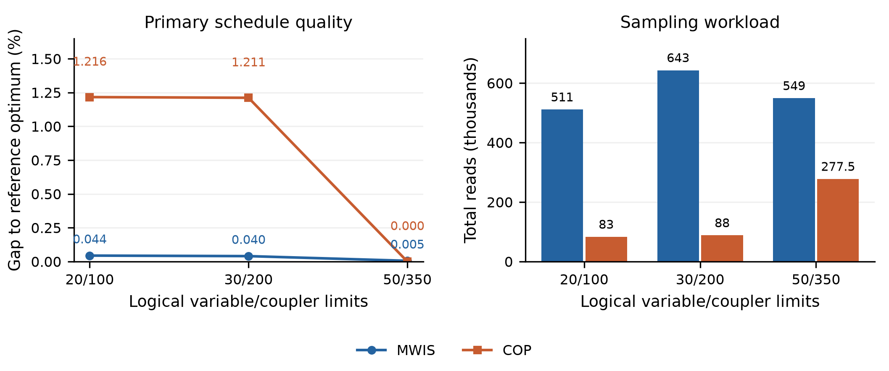

Same frozen 200/50 input for all three combined limit profiles. Left: primary quality gap; right: total sampled reads over all exported alternative terminal branches. Both methods use 500 reads per terminal. Read counts are sampling workload, not total runtime. Both logical limits change together; changing them also changes the decomposition.

[Vector PDF](03_terminal_profile_tradeoff.pdf)

### 04_baseline_logical_dimensions

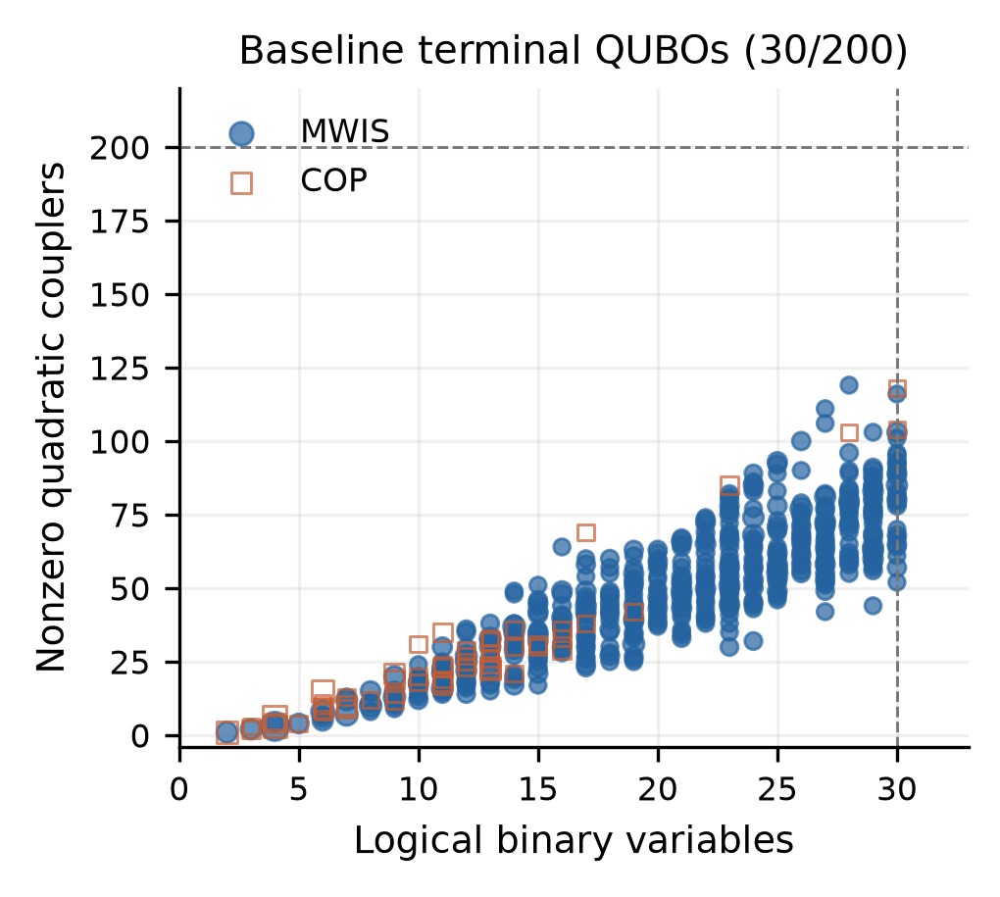

All sampled baseline terminal QUBOs, including alternative branches. Marker area increases with repeated dimension pairs; dashed lines are logical limits. One-hot MWIS and domain-wall COP counts use common binary-variable/coupler units. These are not physical qubits, chains or embedding overhead; no hardware embedding was performed. Include this PDF at 86 mm width.

[Vector PDF](04_baseline_logical_dimensions.pdf)

### 05_producer_stage_profile

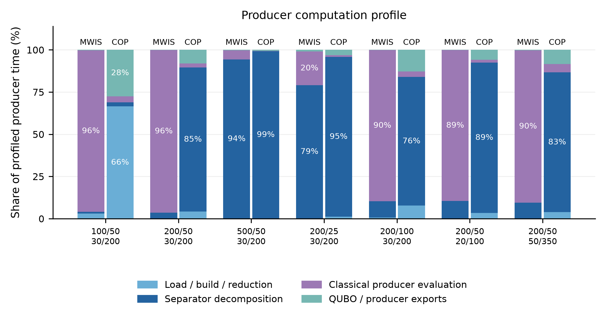

Shares of four disjoint logged producer phases, excluding unprofiled notebook overhead, sampling, reconstruction and MILP/LP solver calls. Classical producer evaluation includes exact terminal reference evaluation and incomplete-leaf evaluation; it is displayed separately and is not sampling. Recursive reductions lie within decomposition. Nested component/operation clocks are not added again. Absolute seconds are in timing_records.csv; shares do not establish a controlled speed comparison. This is not a complete primary-pipeline runtime.

[Vector PDF](05_producer_stage_profile.pdf)

### S01_primary_retention_and_incomplete_leaves

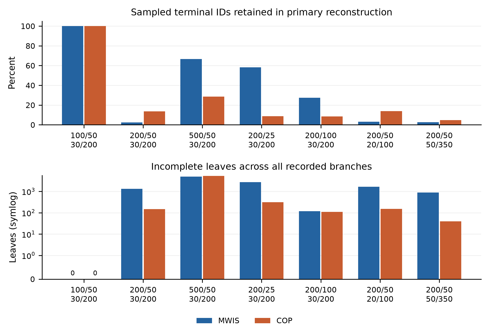

Retention is evaluated before MILP: terminal IDs present in the selected reconstruction divided by all sampled terminal IDs. It is not a contact share. Incomplete leaves count all recorded alternatives, not just the selected branch. Zero incomplete leaves are shown explicitly. The shared baseline appears once.

[Vector PDF](S01_primary_retention_and_incomplete_leaves.pdf)

### S02_average_terminal_dimensions

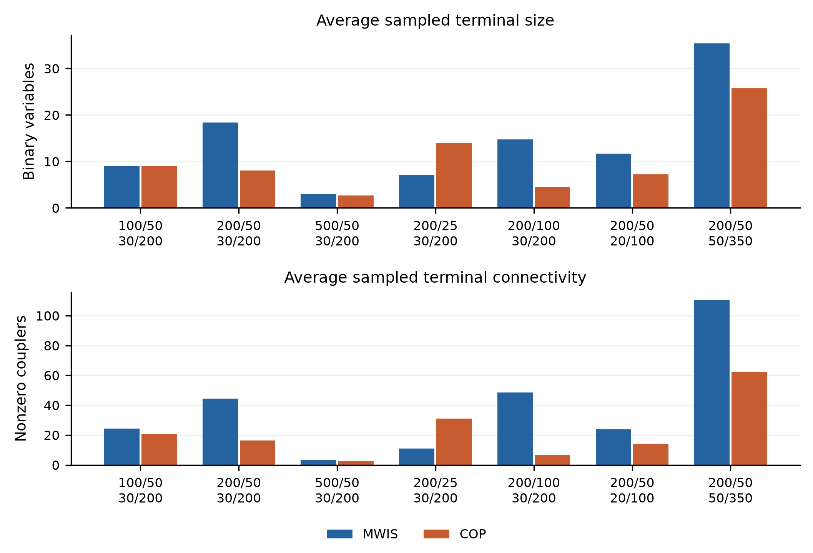

Arithmetic means across all non-empty sampled terminals, including alternatives discarded during reconstruction. These are workload dimensions, not sizes of the full unresolved problem or exclusively of retained terminals. Binary-variable and coupler units are common to both encodings.

[Vector PDF](S02_average_terminal_dimensions.pdf)

### S03_common_reduced_component_structure

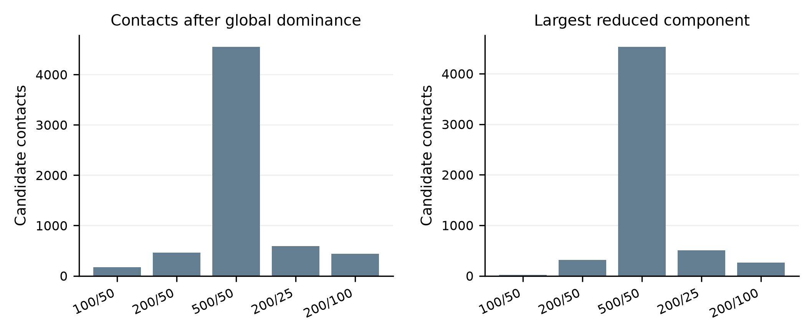

One bar per dataset represents both methods: retained weighted vertices and edge sets are independently hash-checked identical after global dominance. Sizes are candidate contacts, not COP satellite variables. Only the five distinct datasets are shown; terminal profiles reuse the same reduced 200/50 graph.

[Vector PDF](S03_common_reduced_component_structure.pdf)

### S04_terminal_and_incomplete_leaf_distributions

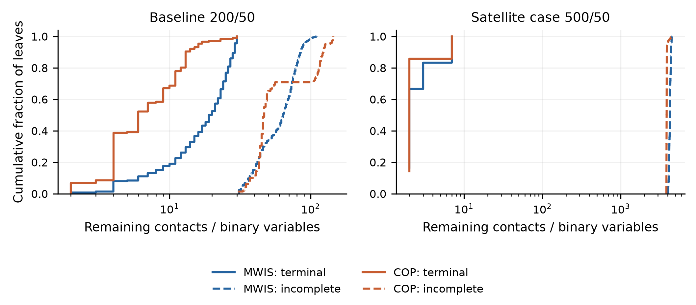

Empirical distributions of all recorded terminal and incomplete leaves for the baseline and largest satellite case. They describe bounded-tree workloads, not repeated-run uncertainty. Empty fixed-choice leaves are excluded. Means of sampled terminal sizes alone can conceal large unresolved pieces. Current encodings use one bit per retained contact alternative.

[Vector PDF](S04_terminal_and_incomplete_leaf_distributions.pdf)

### 01a_primary_quality_satellite_scaling

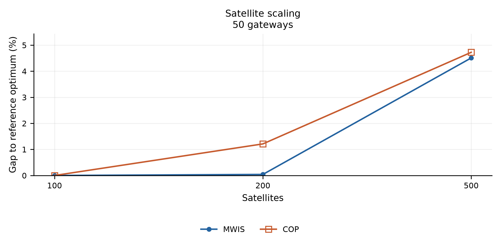

Primary schedule gaps to certified reference optima, excluding MILP-generated contacts. Satellite scaling with 50 gateways and limits 30/200. The baseline is reused. Active resource identities are not fully nested, so differences describe the selected scenarios rather than a strictly isolated resource-count effect. Both methods use the same candidate CSV within each pair.

[Vector PDF](01a_primary_quality_satellite_scaling.pdf)

### 01b_primary_quality_gateway_scaling

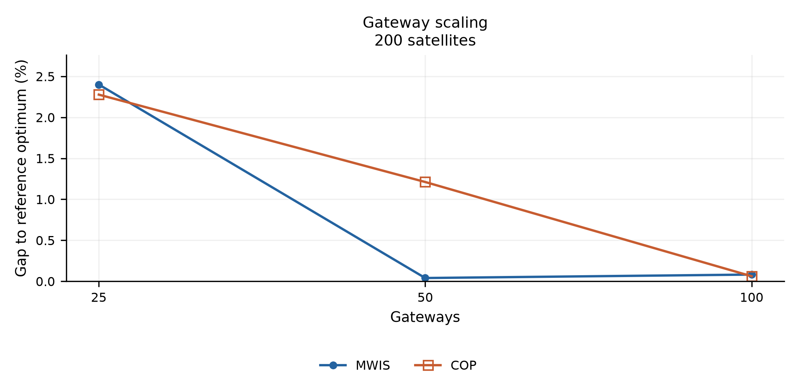

Primary schedule gaps to certified reference optima, excluding MILP-generated contacts. Gateway scaling with 200 satellites and limits 30/200. The baseline is reused. Active resource identities are not fully nested, so differences describe the selected scenarios rather than a strictly isolated resource-count effect. Both methods use the same candidate CSV within each pair.

[Vector PDF](01b_primary_quality_gateway_scaling.pdf)

### 03a_terminal_profile_primary_quality

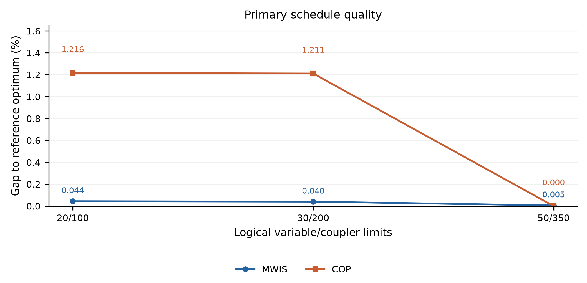

Same frozen 200/50 input for all three combined limit profiles. Primary schedule gap to the certified reference optimum, before MILP evaluation. Both methods use 500 reads per terminal. Read counts are sampling workload, not total runtime. Both logical limits change together; changing them also changes the decomposition.

[Vector PDF](03a_terminal_profile_primary_quality.pdf)

### 03b_terminal_profile_sampling_workload

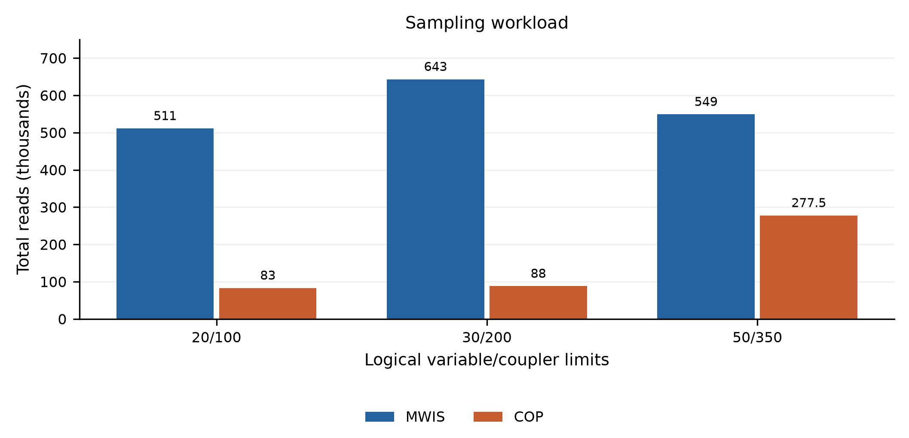

Same frozen 200/50 input for all three combined limit profiles. Total sampled reads over all exported alternative terminal branches, including branches discarded in reconstruction. Both methods use 500 reads per terminal. Read counts are sampling workload, not total runtime. Both logical limits change together; changing them also changes the decomposition.

[Vector PDF](03b_terminal_profile_sampling_workload.pdf)

### S01a_primary_terminal_retention

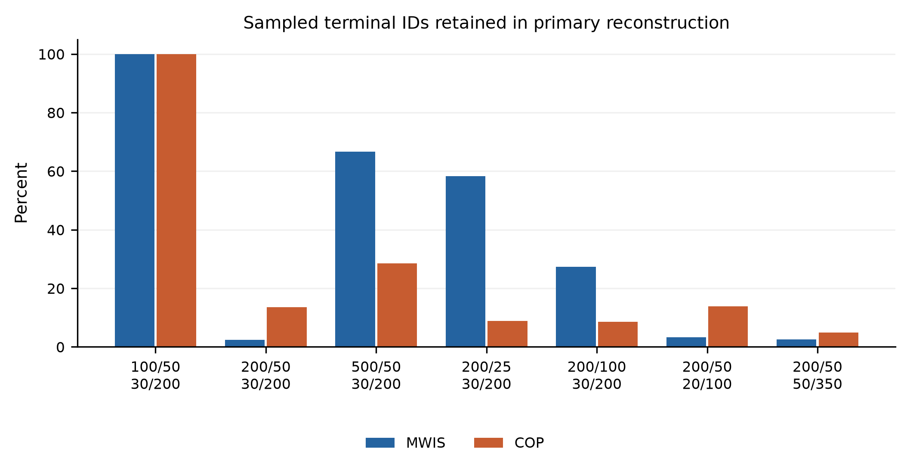

Fraction of sampled terminal IDs retained in the selected primary reconstruction, before MILP replacement. It is not a contact or objective share, and does not measure sampling workload saved. The shared baseline appears once.

[Vector PDF](S01a_primary_terminal_retention.pdf)

### S01b_incomplete_leaves

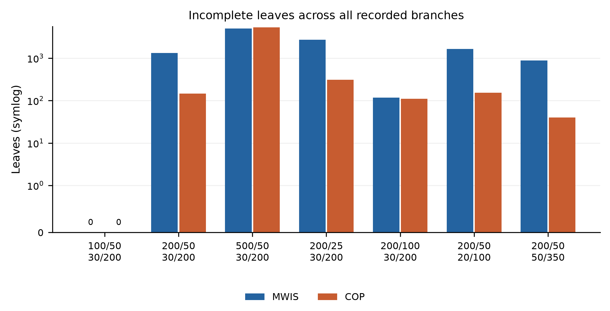

Incomplete leaves across all recorded decomposition branches, including alternatives discarded in primary reconstruction. The symlog scale shows zero leaves explicitly. Counts are bounded-tree workload, not counts of natural connected components. The shared baseline appears once.

[Vector PDF](S01b_incomplete_leaves.pdf)

### S02a_average_terminal_variables

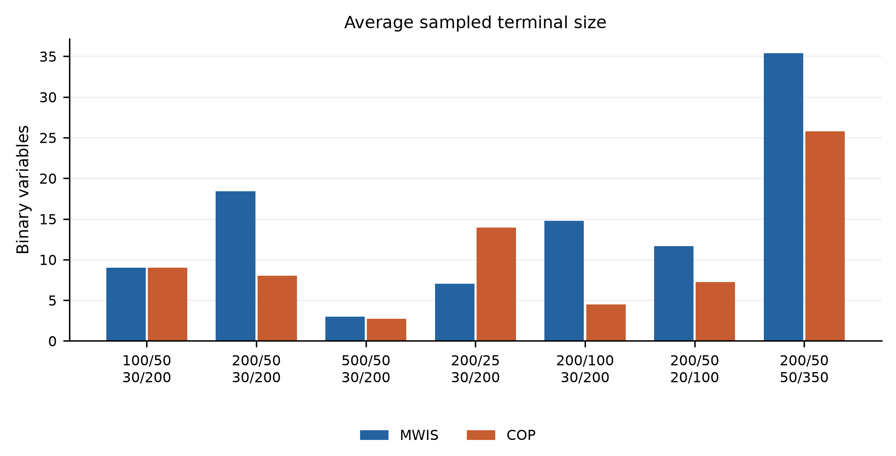

Arithmetic means across all non-empty sampled terminals, including alternatives discarded during reconstruction. These are workload dimensions, not sizes of the full unresolved problem or exclusively of retained terminals. Sizes count logical binary variables, not COP satellite variables or physical qubits.

[Vector PDF](S02a_average_terminal_variables.pdf)

### S02b_average_terminal_couplers

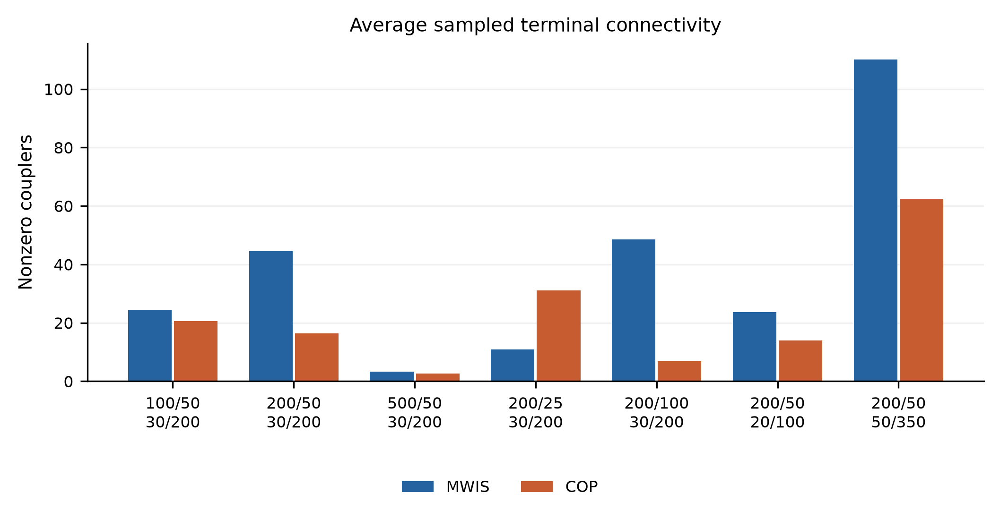

Arithmetic means across all non-empty sampled terminals, including alternatives discarded during reconstruction. These are workload dimensions, not sizes of the full unresolved problem or exclusively of retained terminals. Connectivity counts nonzero logical quadratic couplers, not physical hardware couplers.

[Vector PDF](S02b_average_terminal_couplers.pdf)

### S03a_contacts_after_global_dominance

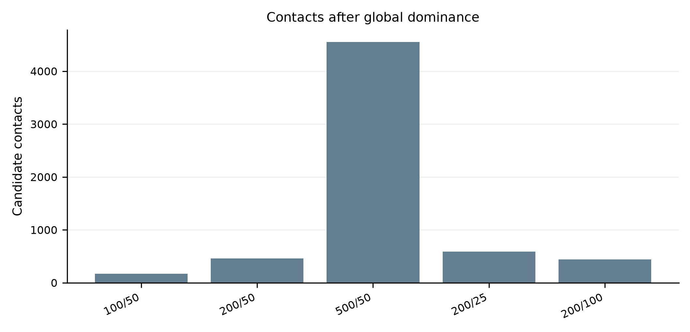

One bar per dataset represents both methods: retained weighted vertices and edge sets are independently hash-checked identical after global dominance. Sizes are candidate contacts, not COP satellite variables. Only the five distinct datasets are shown; terminal profiles reuse the same reduced 200/50 graph.

[Vector PDF](S03a_contacts_after_global_dominance.pdf)

### S03b_largest_reduced_component

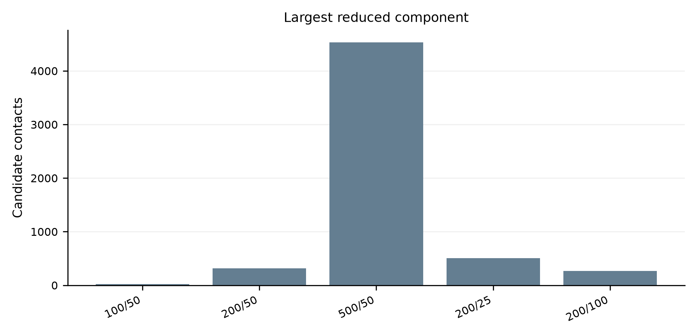

One bar per dataset represents both methods: retained weighted vertices and edge sets are independently hash-checked identical after global dominance. Sizes are candidate contacts, not COP satellite variables. Only the five distinct datasets are shown; terminal profiles reuse the same reduced 200/50 graph.

[Vector PDF](S03b_largest_reduced_component.pdf)

### S04a_leaf_distributions_baseline

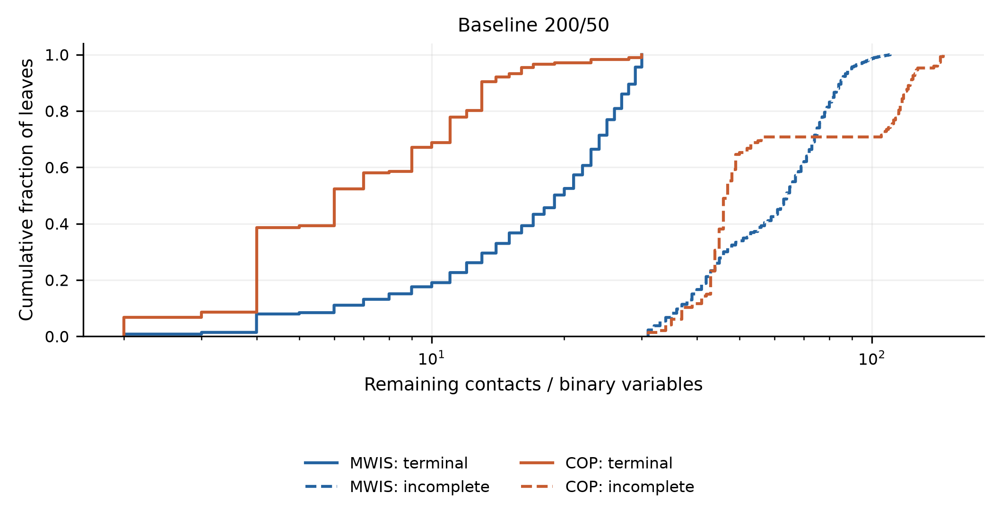

Empirical distributions of all recorded terminal and incomplete leaves for the baseline 200/50 case. They describe bounded-tree workloads, not repeated-run uncertainty. Empty fixed-choice leaves are excluded. Means of sampled terminal sizes alone can conceal large unresolved pieces. Current encodings use one bit per retained contact alternative.

[Vector PDF](S04a_leaf_distributions_baseline.pdf)

### S04b_leaf_distributions_s500_g50

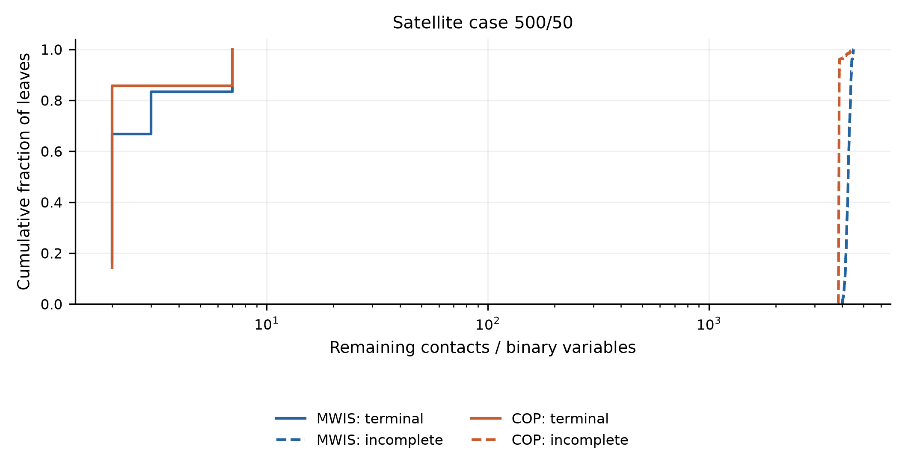

Empirical distributions of all recorded terminal and incomplete leaves for the largest satellite case, 500/50. They describe bounded-tree workloads, not repeated-run uncertainty. Empty fixed-choice leaves are excluded. Means of sampled terminal sizes alone can conceal large unresolved pieces. Current encodings use one bit per retained contact alternative.

[Vector PDF](S04b_leaf_distributions_s500_g50.pdf)

### 01a_primary_quality_satellite_scaling_column

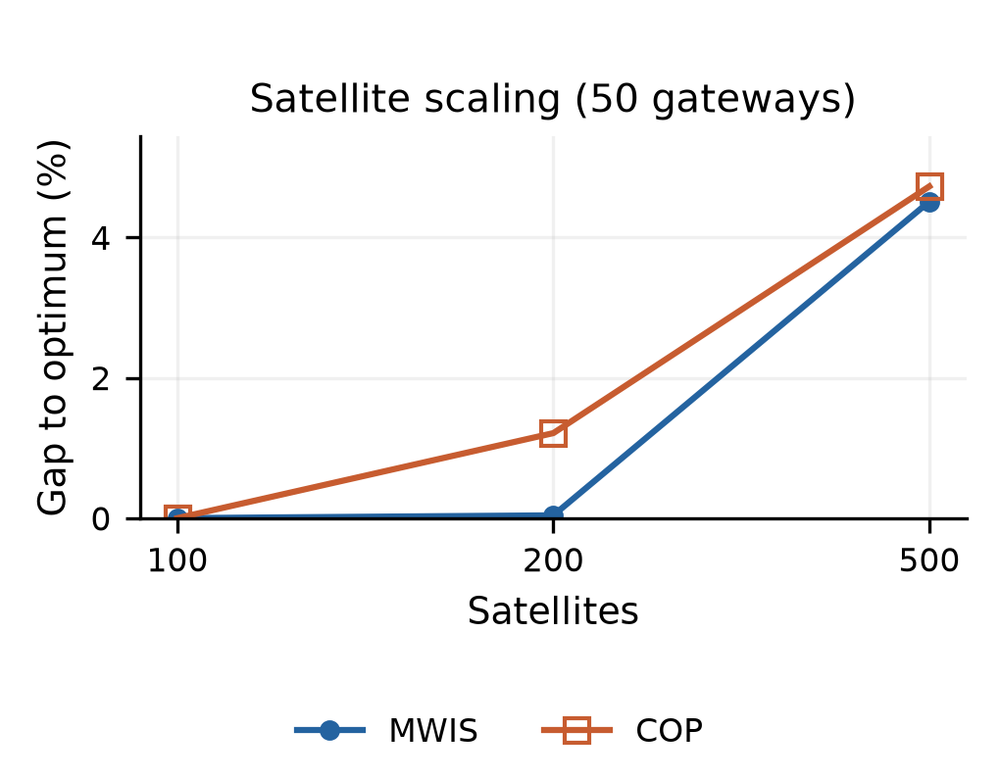

Primary schedule gaps to certified reference optima, excluding MILP-generated contacts. Satellite scaling with 50 gateways and limits 30/200. The baseline is reused. Active resource identities are not fully nested, so differences describe the selected scenarios rather than a strictly isolated resource-count effect. Both methods use the same candidate CSV within each pair.

[Vector PDF](01a_primary_quality_satellite_scaling_column.pdf)

### 01b_primary_quality_gateway_scaling_column

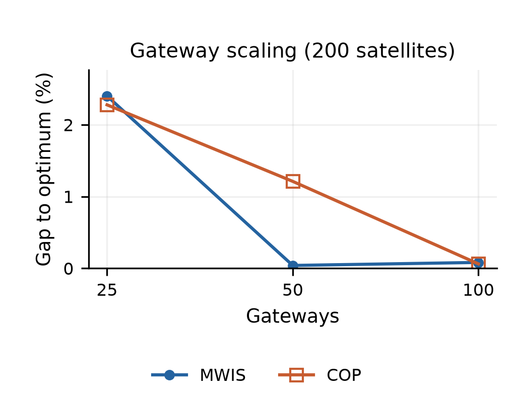

Primary schedule gaps to certified reference optima, excluding MILP-generated contacts. Gateway scaling with 200 satellites and limits 30/200. The baseline is reused. Active resource identities are not fully nested, so differences describe the selected scenarios rather than a strictly isolated resource-count effect. Both methods use the same candidate CSV within each pair.

[Vector PDF](01b_primary_quality_gateway_scaling_column.pdf)

### 03a_terminal_profile_primary_quality_column

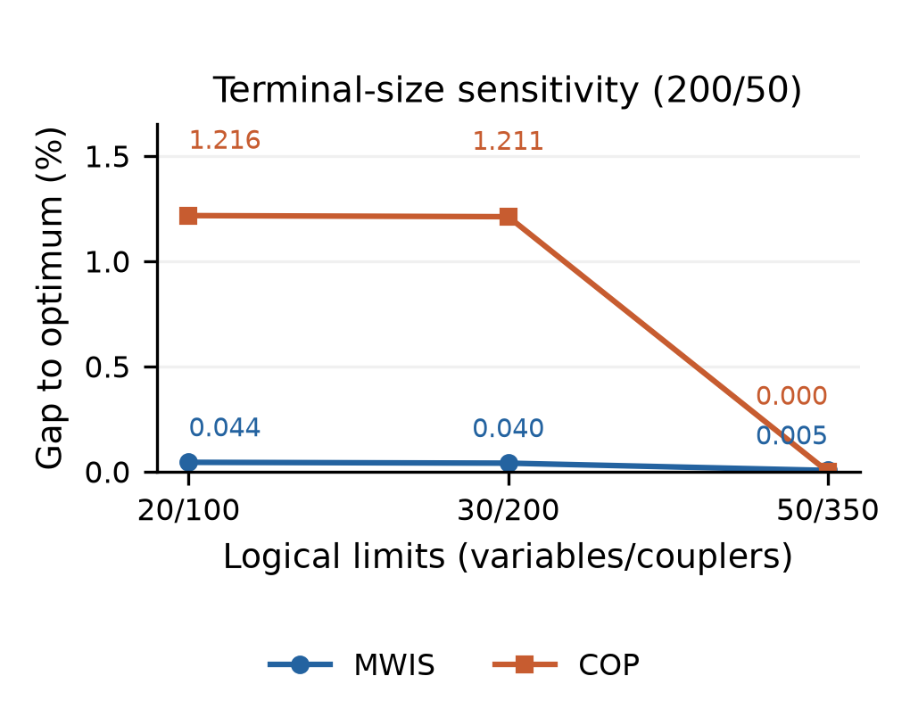

Same frozen 200/50 input for all three combined limit profiles. Primary schedule gap to the certified reference optimum, before MILP evaluation. Both methods use 500 reads per terminal. Read counts are sampling workload, not total runtime. Both logical limits change together; changing them also changes the decomposition.

[Vector PDF](03a_terminal_profile_primary_quality_column.pdf)

### schedule_gantt_s100_g50_primary_excerpt

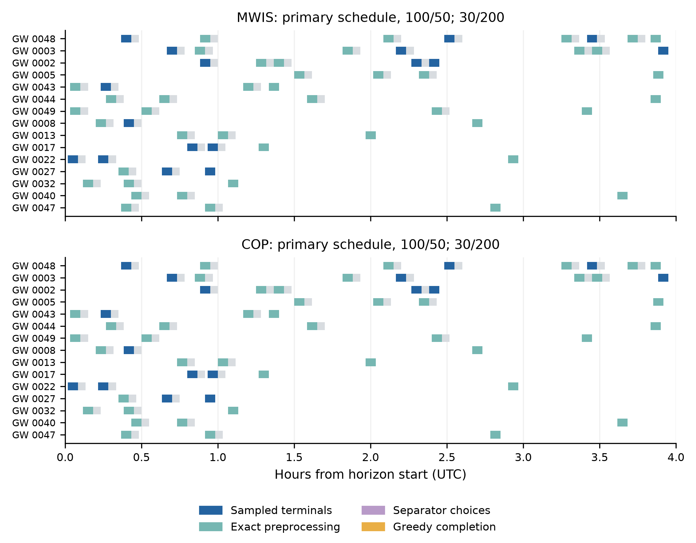

Primary schedule excerpt before reference solving: the 15 gateways with highest combined MWIS/COP primary contact counts, ties by station ID. Both panels use the same gateway order and four-hour horizon. Contacts are coloured by primary provenance; grey setup reservations occur only between successive selected contacts. This is an excerpt, not the full schedule. All primary contacts and all gateways are exported in schedule_metrics.csv and gateway_metrics.csv.

[Vector PDF](schedule_gantt_s100_g50_primary_excerpt.pdf)

### gateway_activity_s100_g50_primary_excerpt

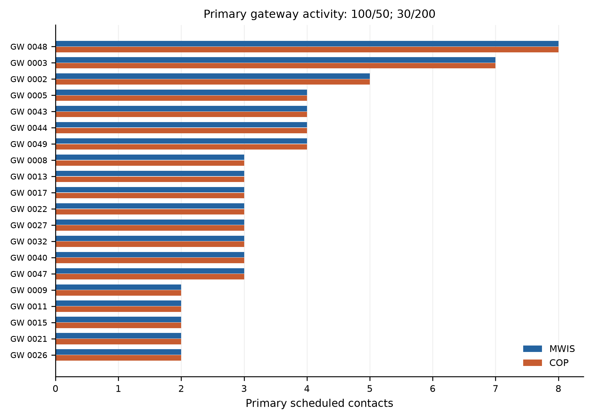

Primary contact counts for the 20 busiest gateways ranked by combined MWIS/COP counts, with deterministic station-ID ties. Remaining and zero-contact gateways are retained in gateway_metrics.csv. Counts concern the simplified single-antenna, one-contact-per-satellite model, not real network efficiency. Contact minutes and service occupancy (excluding setup) are available for every gateway in the exported table.

[Vector PDF](gateway_activity_s100_g50_primary_excerpt.pdf)

### schedule_gantt_baseline_primary_excerpt

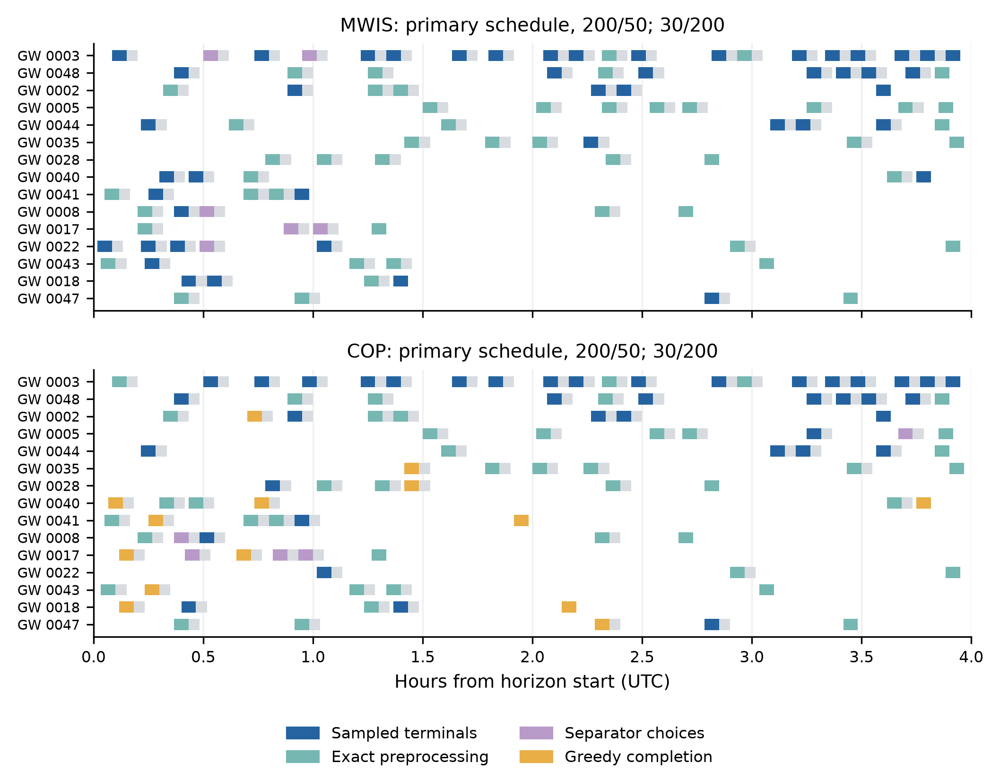

Primary schedule excerpt before reference solving: the 15 gateways with highest combined MWIS/COP primary contact counts, ties by station ID. Both panels use the same gateway order and four-hour horizon. Contacts are coloured by primary provenance; grey setup reservations occur only between successive selected contacts. This is an excerpt, not the full schedule. All primary contacts and all gateways are exported in schedule_metrics.csv and gateway_metrics.csv.

[Vector PDF](schedule_gantt_baseline_primary_excerpt.pdf)

### gateway_activity_baseline_primary_excerpt

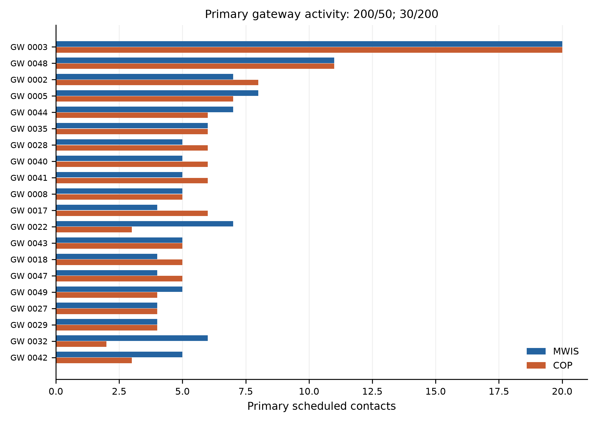

Primary contact counts for the 20 busiest gateways ranked by combined MWIS/COP counts, with deterministic station-ID ties. Remaining and zero-contact gateways are retained in gateway_metrics.csv. Counts concern the simplified single-antenna, one-contact-per-satellite model, not real network efficiency. Contact minutes and service occupancy (excluding setup) are available for every gateway in the exported table.

[Vector PDF](gateway_activity_baseline_primary_excerpt.pdf)

### schedule_gantt_s500_g50_primary_excerpt

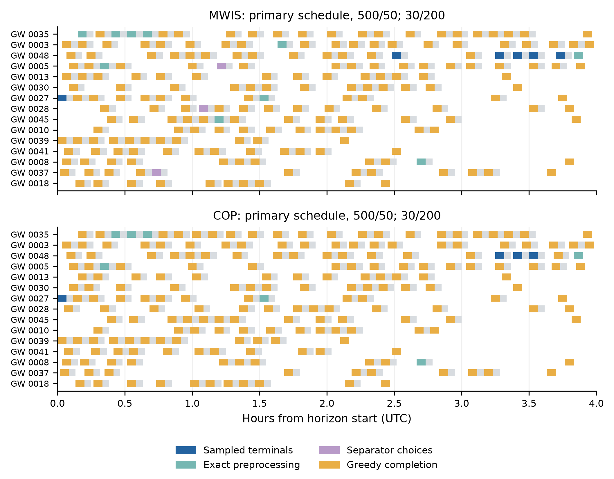

Primary schedule excerpt before reference solving: the 15 gateways with highest combined MWIS/COP primary contact counts, ties by station ID. Both panels use the same gateway order and four-hour horizon. Contacts are coloured by primary provenance; grey setup reservations occur only between successive selected contacts. This is an excerpt, not the full schedule. All primary contacts and all gateways are exported in schedule_metrics.csv and gateway_metrics.csv.

[Vector PDF](schedule_gantt_s500_g50_primary_excerpt.pdf)

### gateway_activity_s500_g50_primary_excerpt

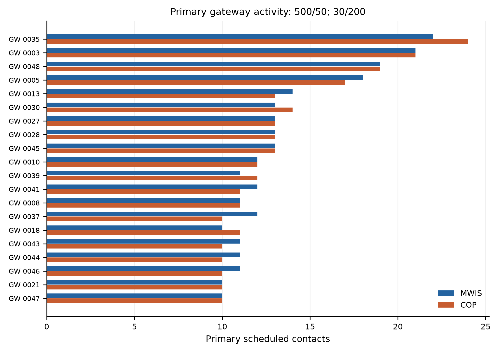

Primary contact counts for the 20 busiest gateways ranked by combined MWIS/COP counts, with deterministic station-ID ties. Remaining and zero-contact gateways are retained in gateway_metrics.csv. Counts concern the simplified single-antenna, one-contact-per-satellite model, not real network efficiency. Contact minutes and service occupancy (excluding setup) are available for every gateway in the exported table.

[Vector PDF](gateway_activity_s500_g50_primary_excerpt.pdf)

### schedule_gantt_s200_g25_primary_excerpt

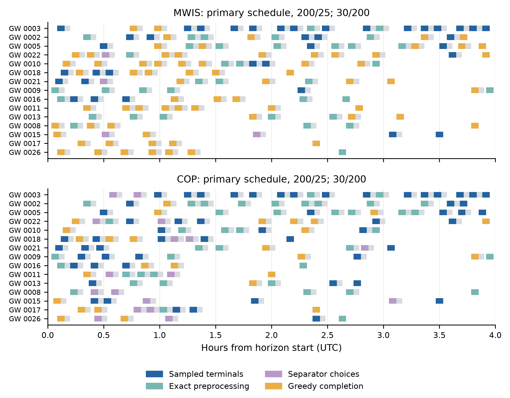

Primary schedule excerpt before reference solving: the 15 gateways with highest combined MWIS/COP primary contact counts, ties by station ID. Both panels use the same gateway order and four-hour horizon. Contacts are coloured by primary provenance; grey setup reservations occur only between successive selected contacts. This is an excerpt, not the full schedule. All primary contacts and all gateways are exported in schedule_metrics.csv and gateway_metrics.csv.

[Vector PDF](schedule_gantt_s200_g25_primary_excerpt.pdf)

### gateway_activity_s200_g25_primary_excerpt

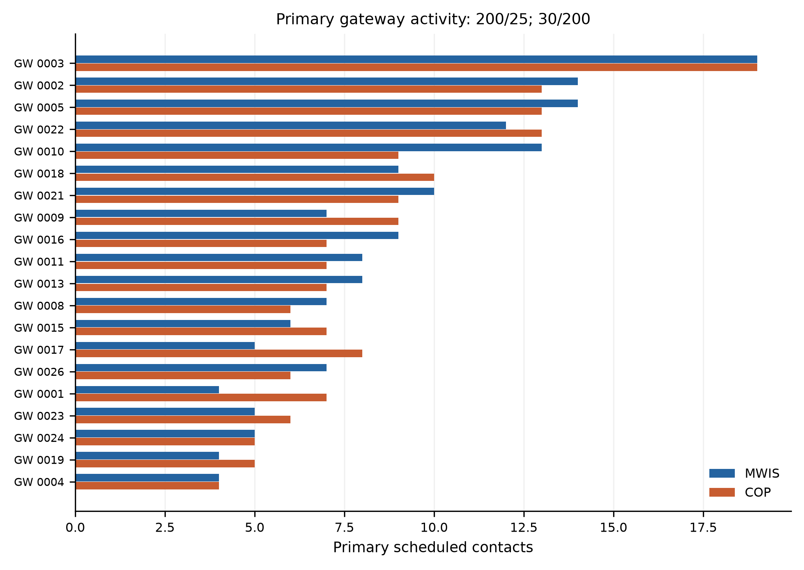

Primary contact counts for the 20 busiest gateways ranked by combined MWIS/COP counts, with deterministic station-ID ties. Remaining and zero-contact gateways are retained in gateway_metrics.csv. Counts concern the simplified single-antenna, one-contact-per-satellite model, not real network efficiency. Contact minutes and service occupancy (excluding setup) are available for every gateway in the exported table.

[Vector PDF](gateway_activity_s200_g25_primary_excerpt.pdf)

### schedule_gantt_s200_g100_primary_excerpt

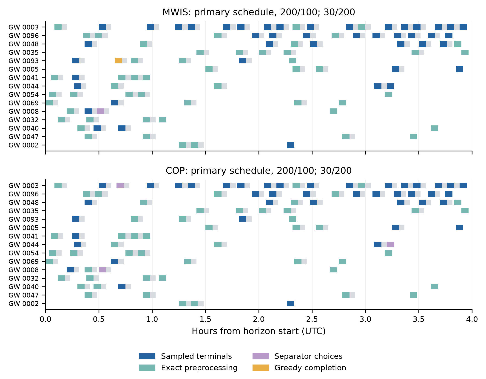

Primary schedule excerpt before reference solving: the 15 gateways with highest combined MWIS/COP primary contact counts, ties by station ID. Both panels use the same gateway order and four-hour horizon. Contacts are coloured by primary provenance; grey setup reservations occur only between successive selected contacts. This is an excerpt, not the full schedule. All primary contacts and all gateways are exported in schedule_metrics.csv and gateway_metrics.csv.

[Vector PDF](schedule_gantt_s200_g100_primary_excerpt.pdf)

### gateway_activity_s200_g100_primary_excerpt

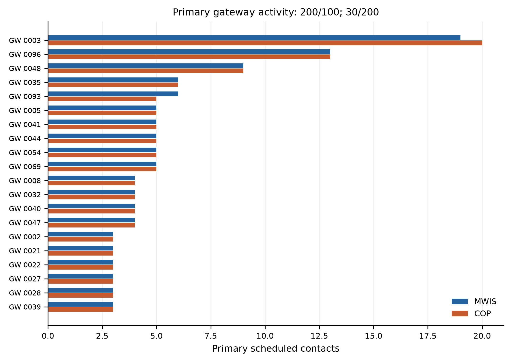

Primary contact counts for the 20 busiest gateways ranked by combined MWIS/COP counts, with deterministic station-ID ties. Remaining and zero-contact gateways are retained in gateway_metrics.csv. Counts concern the simplified single-antenna, one-contact-per-satellite model, not real network efficiency. Contact minutes and service occupancy (excluding setup) are available for every gateway in the exported table.

[Vector PDF](gateway_activity_s200_g100_primary_excerpt.pdf)

### schedule_gantt_n20_c100_primary_excerpt

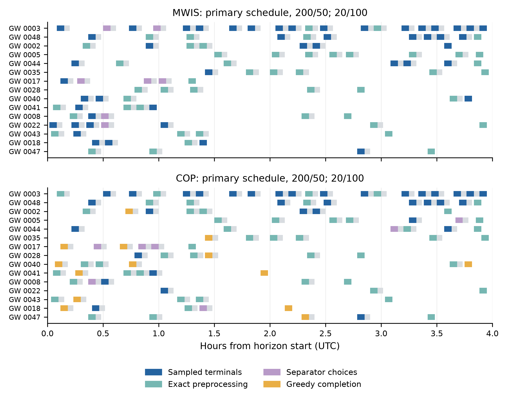

Primary schedule excerpt before reference solving: the 15 gateways with highest combined MWIS/COP primary contact counts, ties by station ID. Both panels use the same gateway order and four-hour horizon. Contacts are coloured by primary provenance; grey setup reservations occur only between successive selected contacts. This is an excerpt, not the full schedule. All primary contacts and all gateways are exported in schedule_metrics.csv and gateway_metrics.csv.

[Vector PDF](schedule_gantt_n20_c100_primary_excerpt.pdf)

### gateway_activity_n20_c100_primary_excerpt

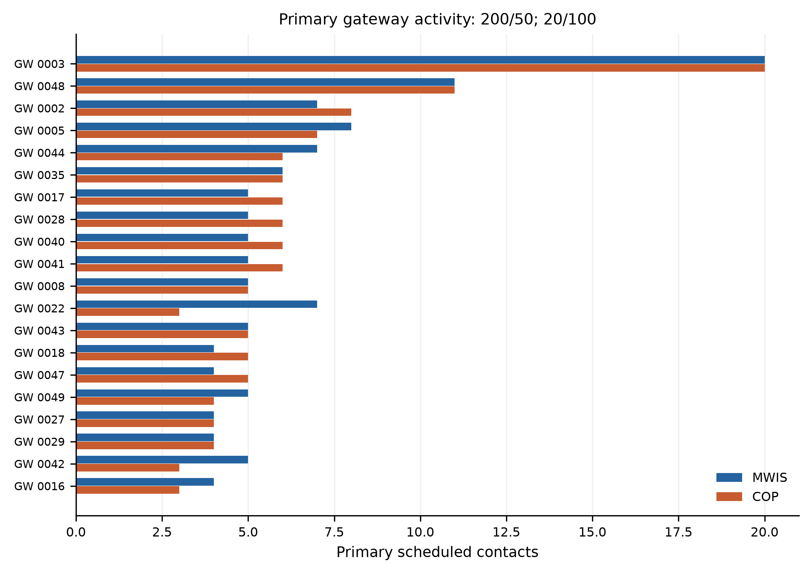

Primary contact counts for the 20 busiest gateways ranked by combined MWIS/COP counts, with deterministic station-ID ties. Remaining and zero-contact gateways are retained in gateway_metrics.csv. Counts concern the simplified single-antenna, one-contact-per-satellite model, not real network efficiency. Contact minutes and service occupancy (excluding setup) are available for every gateway in the exported table.

[Vector PDF](gateway_activity_n20_c100_primary_excerpt.pdf)

### schedule_gantt_n50_c350_primary_excerpt

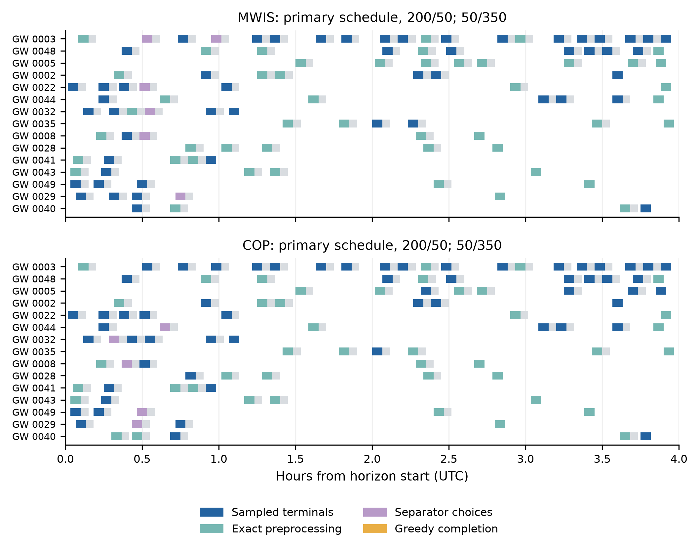

Primary schedule excerpt before reference solving: the 15 gateways with highest combined MWIS/COP primary contact counts, ties by station ID. Both panels use the same gateway order and four-hour horizon. Contacts are coloured by primary provenance; grey setup reservations occur only between successive selected contacts. This is an excerpt, not the full schedule. All primary contacts and all gateways are exported in schedule_metrics.csv and gateway_metrics.csv.

[Vector PDF](schedule_gantt_n50_c350_primary_excerpt.pdf)

### gateway_activity_n50_c350_primary_excerpt

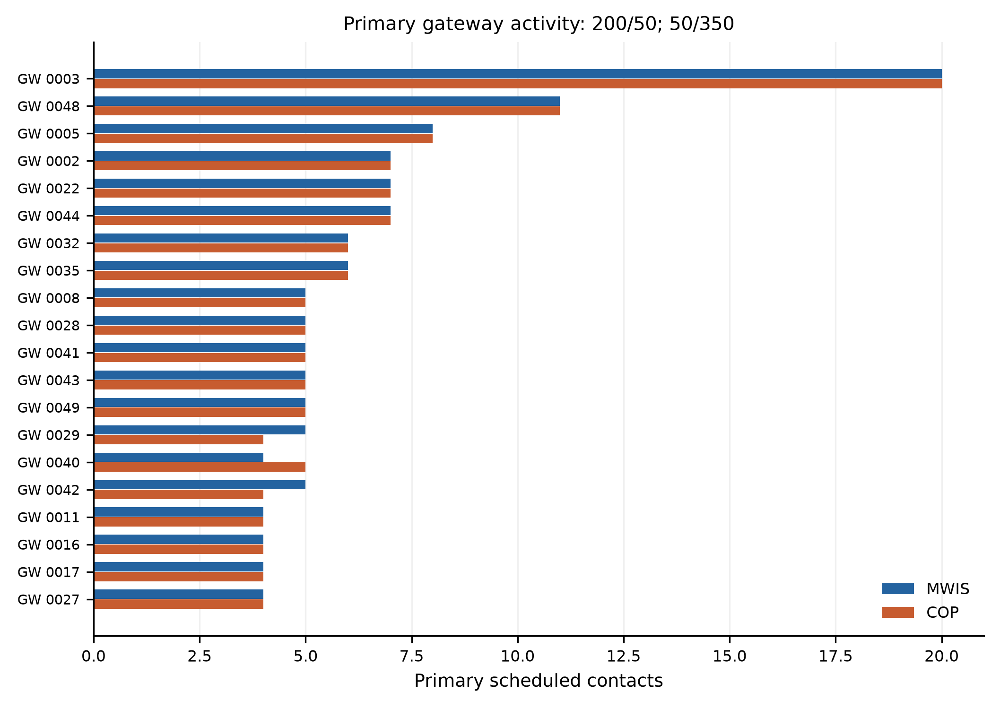

Primary contact counts for the 20 busiest gateways ranked by combined MWIS/COP counts, with deterministic station-ID ties. Remaining and zero-contact gateways are retained in gateway_metrics.csv. Counts concern the simplified single-antenna, one-contact-per-satellite model, not real network efficiency. Contact minutes and service occupancy (excluding setup) are available for every gateway in the exported table.

[Vector PDF](gateway_activity_n50_c350_primary_excerpt.pdf)
