# CSP and MWIS comparison figures

Generated by `results/5_csp_mwis_comparison_plots.py`. This report uses only the completed MWIS campaign `mwis-dominance-enhanced` and the team's extracted CSP runs on `exp_snapshot_2026-10-12`. All seven completed dominance-enhanced MWIS runs are included; original MWIS runs are excluded. No experiment is executed or modified.

## Reading the comparison

- All seven configurations are matched by frozen input, satellite/gateway counts, and logical terminal limits. Each of the 14 method/configuration records is loaded once.
- The shared baseline is MWIS `baseline_s200_g50` and CSP `csp_gs_sweep/gs_s200_g50`. It appears in each experiment group as a common reference, not an independent replicate. The other CSP baseline copies are not additional trials.
- CSP uses domain-wall encoding and dominance reduction; this MWIS campaign uses one-hot encoding with global and recursive dominance. The figures compare the implemented pipelines, not isolated formulation effects.
- MWIS uses 500 reads per terminal and CSP uses 1,000. Total budgets differ further because terminal counts differ. Seeds and one run per setting do not provide statistical error bars.
- Objective means original schedule weight. QUBO energy is not compared across encodings or reward scales.
- Average subproblem size means binary variables/couplers across every non-empty sampled terminal, including alternative branches later discarded. It does not mix native CSP satellite variables with MWIS contact vertices.
- Dimensions are logical QUBO dimensions. Physical embedding qubits, chain lengths and chain breaks are unavailable because these experiments used classical simulated annealing.
- Hardware/runtime environments were not matched, and CSP hardware/environment provenance is incomplete. Runtime plots describe recorded executions; they do not establish a controlled algorithmic speedup.
- The CSP 100/50 run lacks full-notebook timing. Its producer stopwatch is plotted as partial and its total remains missing. No zero, estimate or reconstructed timing is substituted. No frozen data-generation time is included.
- Producer timing partitions use disjoint logged phases plus unprofiled remainder. Total time sums notebook elapsed times and excludes outer launcher/orchestration overhead. CSP does not record sampling separately, so both methods use a combined annealing/reconstruction notebook remainder after subtracting recorded MILP/LP solver time. Nested component clocks are excluded to avoid double counting.

## Why few sampled QUBOs can still give a high pre-MILP objective

Pre-MILP reconstruction combines sampled terminals, exact fixed contacts, separator choices and greedy incomplete leaves. In the selected MWIS baseline, the pre-MILP schedule contains 80 contacts from sampled terminals, 90 from exact preprocessing, 10 from separator assignments, and 0 from greedy fallback. Their combined weight is 12,576.412; this is not an annealer-only objective. MILP later replaces the incomplete component. A QUBO count therefore cannot by itself explain schedule quality or retained annealing contribution.

## Outputs and regeneration

Run with the project Python interpreter:

```powershell
& 'C:/Users/felip/AppData/Local/Python/pythoncore-3.13-64/python.exe' -B -X utf8 results/5_csp_mwis_comparison_plots.py --mwis-variant dominance --output-dir results/figures/csp_mwis_reordered_dominance
```

Use `--output-dir PATH` for another analysis directory. Figures are saved as 200-DPI PNGs and vector PDFs. By default, Gantt and gateway-activity views are generated for all seven configurations; use `--schedule-scenarios baseline` to generate those views only for the baseline, or pass several scenario keys. The gallery and captions list only figures generated by the current invocation; older files in the analysis directory are preserved.

`comparison_metrics.csv` contains run-level measurements and all three quality stages; `terminal_metrics.csv` contains each terminal and its retention flag; `leaf_metrics.csv` and `leaf_size_distribution_summary.csv` contain terminal/unresolved-leaf sizes; `schedule_metrics.csv` contains final selected contacts; `gateway_metrics.csv` contains counts, weights, contact minutes and service occupancy for every gateway. `figure_captions.json` contains definitions/limitations, and `source_manifest.json` records exact source hashes and selected run paths. `validation_report.json` records checks. Missing numeric data remain blank in CSV and null in JSON. Inputs are hash-checked again after plotting to confirm they were not modified.

## Other useful analyses

The newly implemented additions are: three-stage quality (09), pre/post-MILP provenance (10), terminal-profile cost/quality (11), terminal and incomplete-leaf ECDFs (12), final-schedule Gantt charts (13), and contacts/service occupancy per gateway (14). Figures 13 and 14 have one matched CSP/MWIS view for each requested configuration.

ECDFs describe recorded tree workloads, not uncertainty across repeated runs. The cost/quality plot compares only terminal profiles on the same frozen 200/50 dataset and uses total reads rather than uncontrolled runtime. Gantt charts use a common four-hour horizon and include unused gateways. Service occupancy counts scheduled contact time only; the one-contact-per-satellite restriction limits it, so low occupancy cannot be interpreted as real-network inefficiency.

Further useful figures require additional measurements: repeated-run distributions for timing and quality; a matched-hardware/matched-read-budget runtime study; and real-QPU embedding overhead/chain lengths.

## Figures

### 01_objective_comparison

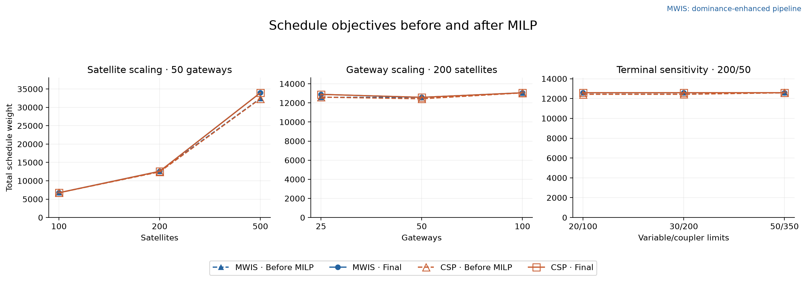

MWIS uses the dominance-enhanced pipeline. Schedule weights, not QUBO energies. Final CSP/MWIS objectives coincide for each matched input; hollow CSP markers reveal the overlap. Shared baseline is reused, not replicated.

[Vector PDF](01_objective_comparison.pdf)

### 02_average_terminal_size

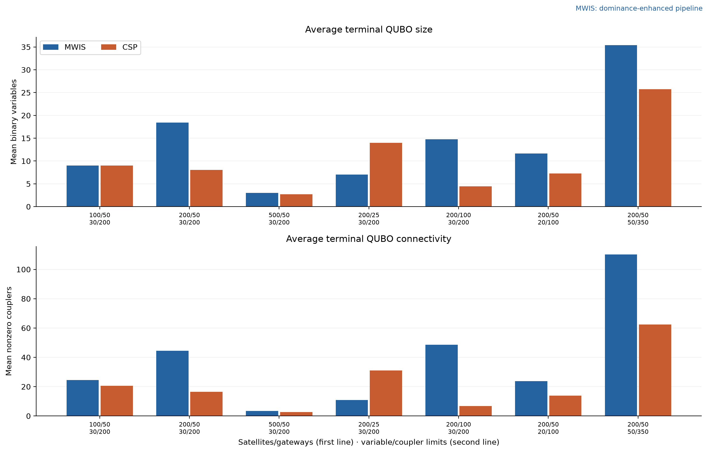

MWIS uses the dominance-enhanced pipeline. Arithmetic means across all exported non-empty terminal QUBOs, including alternative branches later discarded. Both axes use common binary-QUBO units, not CSP satellite-variable counts versus MWIS contact-vertex counts.

[Vector PDF](02_average_terminal_size.pdf)

### 03_runtime_breakdown

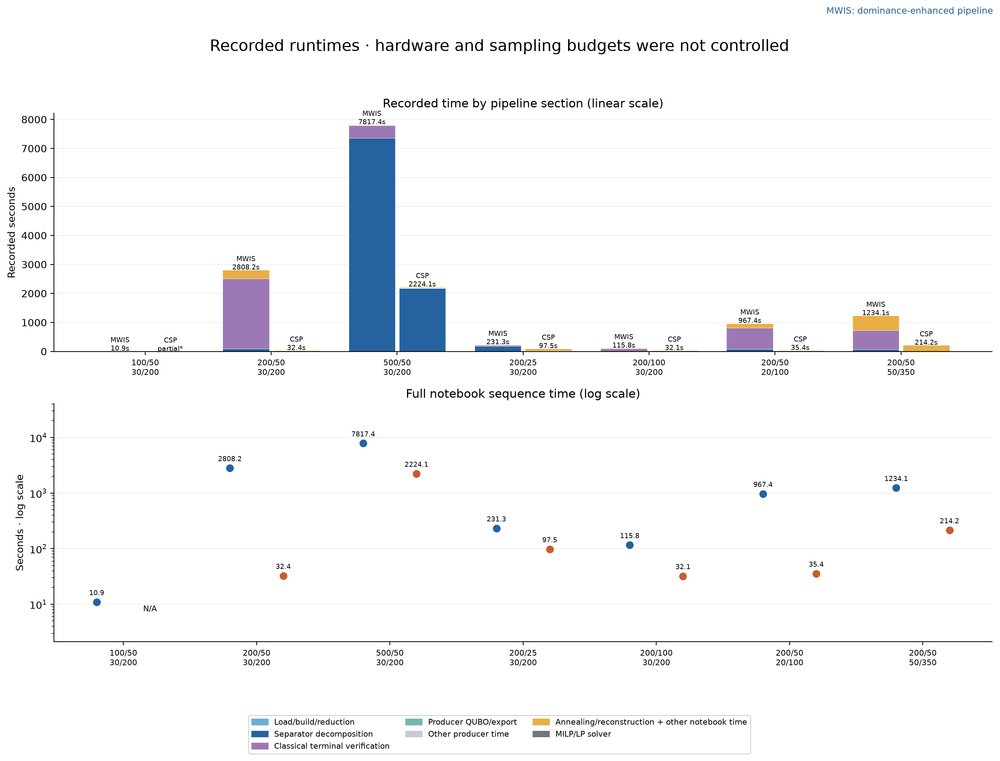

MWIS uses the dominance-enhanced pipeline. CSP hardware/environment provenance is incomplete and sampling budgets differ, so these are recorded timings rather than a controlled speed comparison. Total is the sum of producer and annealing notebook elapsed times; launcher/orchestration overhead is excluded. *CSP 100/50 lacks full notebook clocks: its bar contains only the producer stopwatch and its total is N/A. CSP does not save separate sampling/reconstruction clocks; the annealing notebook remainder combines them with setup/export overhead after subtracting MILP/LP solver time. Producer phases are disjoint; nested component timings and pipeline totals are not added twice. Frozen-input generation time is not measured here.

[Vector PDF](03_runtime_breakdown.pdf)

### 04_logical_qubo_dimensions

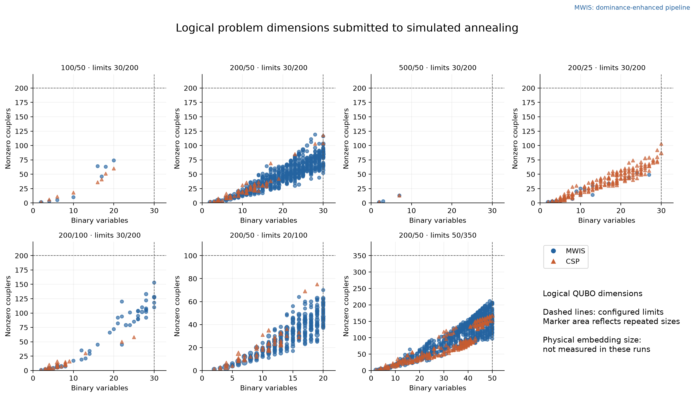

MWIS uses the dominance-enhanced pipeline. Binary variables and nonzero quadratic couplers for sampled terminals. Repeated (variables, couplers) pairs are aggregated; marker area increases with frequency. These are logical dimensions, not physical qubits, chains, chain lengths or embedding overhead. No hardware embedding was performed.

[Vector PDF](04_logical_qubo_dimensions.pdf)

### 05_pre_milp_quality_gap

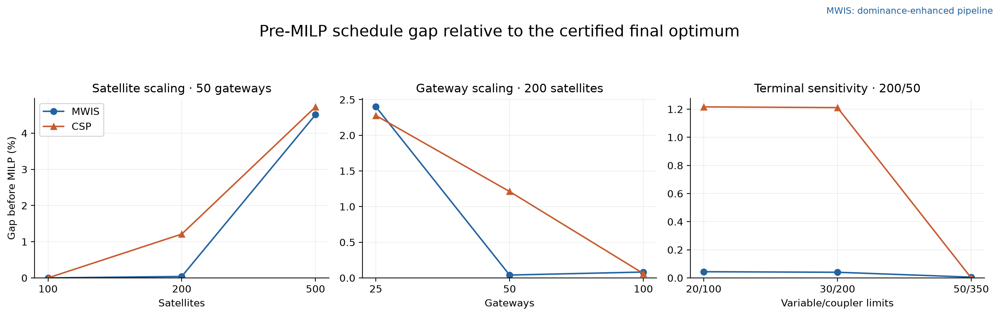

MWIS uses the dominance-enhanced pipeline. 100 × (certified final optimum − reconstructed pre-MILP weight) / certified final optimum. Computed only after confirming final objective equals the saved upper bound. This is the actual retrospective gap for these inputs, distinct from the looser pre-MILP conservative bound. Final certified gaps are zero.

[Vector PDF](05_pre_milp_quality_gap.pdf)

### 06_final_schedule_provenance

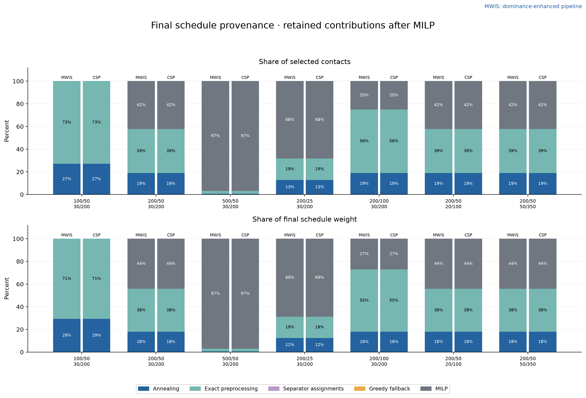

MWIS uses the dominance-enhanced pipeline. Origins traced through the saved decomposition and sampled selections, then replaced by MILP provenance only for affected components. Exact preprocessing and separator choices are classical. Shares measure retained contacts/weight, not CPU work or quantum advantage. A sampled terminal discarded by reconstruction or MILP contributes no retained share.

[Vector PDF](06_final_schedule_provenance.pdf)

### 07_sampling_and_decomposition

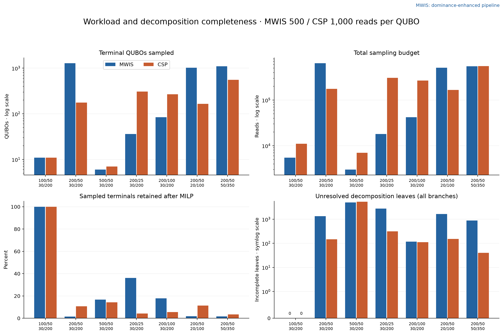

MWIS uses the dominance-enhanced pipeline. Counts include all alternative branches exported as non-empty terminal QUBOs. Total reads are summed from actual annealing_results.csv rows; per-terminal budgets are 500 for MWIS and 1,000 for CSP. Retention uses final terminal IDs, not contact counts. Incomplete leaves are all unresolved branches, not the count selected in the final schedule; zero is kept explicitly.

[Vector PDF](07_sampling_and_decomposition.pdf)

### 08_component_structure

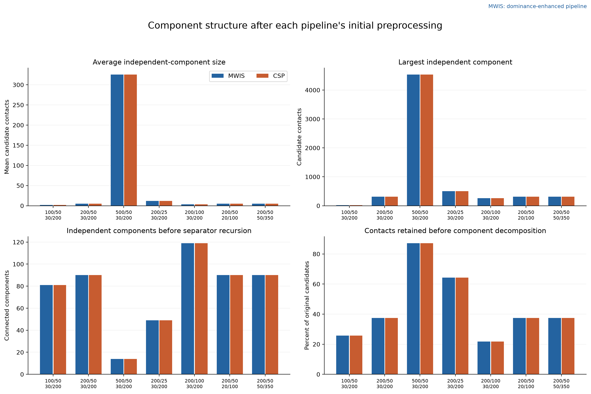

MWIS uses the dominance-enhanced pipeline. Component sizes use candidate contacts in both methods, rather than CSP satellite variables versus MWIS contact vertices. Both pipelines have applied global dominance. Means include singleton components, so the largest component is shown alongside them. These are root components before recursive separator decomposition, not terminal QUBOs or incomplete leaves.

[Vector PDF](08_component_structure.pdf)

### 09_quality_through_stages

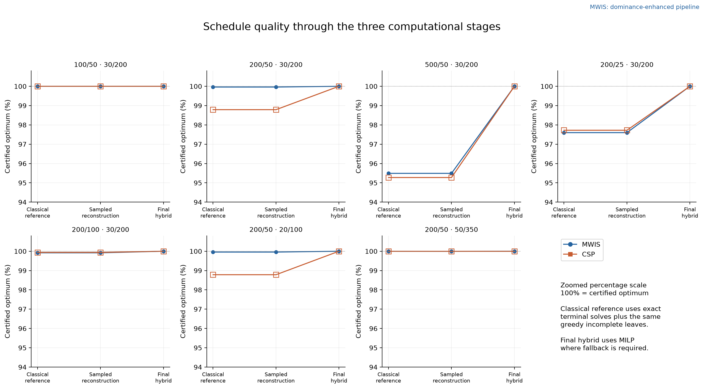

MWIS uses the dominance-enhanced pipeline. Original schedule weights divided by the certified optimum of each input. The percentage axis is zoomed, with the same limits in every panel. Classical reference comes from the saved producer solution and is independently validated; sampled reconstruction comes from the saved tree/read results. Final hybrid may require no MILP for a complete run. In this campaign reference and sampled objectives match in 13 of 14 records. The classical reference is distinct from an annealer-only objective.

[Vector PDF](09_quality_through_stages.pdf)

### 10_pre_post_milp_provenance

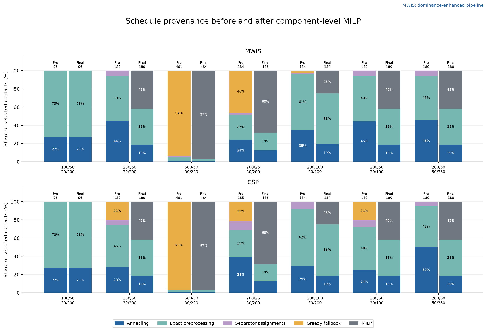

MWIS uses the dominance-enhanced pipeline. Paired bars show provenance of selected contacts before and after MILP; numbers above bars are actual contact counts. Each stage has its own denominator because schedule cardinality may change. These are provenance shares, not identities carried forward: MILP replaces a component solution and can select different contacts. Full pre/post counts and weights are exported in comparison_metrics.csv.

[Vector PDF](10_pre_post_milp_provenance.pdf)

### 11_terminal_profile_cost_quality

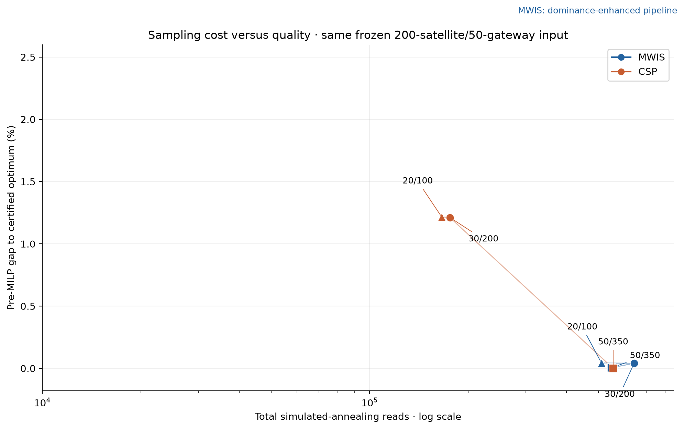

MWIS uses the dominance-enhanced pipeline. Only the terminal-sensitivity profiles on the identical frozen 200/50 input are compared. Labels are logical variable/coupler limits. Total reads measure sampling workload, excluding classical reduction/decomposition/verification cost. Per-terminal budgets differ (MWIS 500, CSP 1,000), and changing both caps changes the decomposition itself; this is an observed profile tradeoff, not an isolated effect of increasing reads or a runtime Pareto claim.

[Vector PDF](11_terminal_profile_cost_quality.pdf)

### 12_leaf_size_distributions

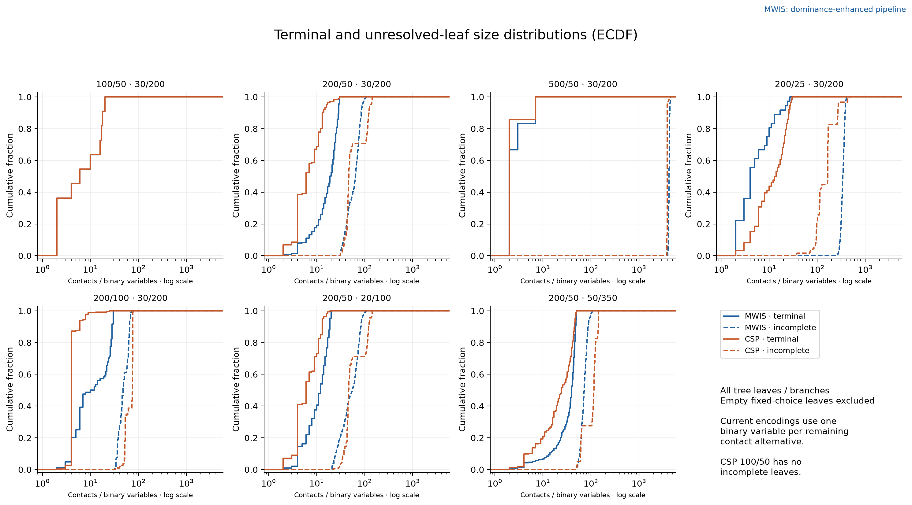

MWIS uses the dominance-enhanced pipeline. Empirical cumulative distributions over all recorded non-empty terminal leaves and incomplete leaves, including alternative separator states; these are workload distributions, not repeated-run uncertainty. Sizes are remaining candidate contacts/binary variables, excluding fixed choices. In the current one-hot/domain-wall encodings one bit is used per contact alternative. Common logarithmic x limits expose large unresolved pieces concealed by average terminal size. Missing incomplete leaves are not plotted as zero-sized observations. Couplers missing in CSP incomplete-leaf metadata remain blank in leaf_metrics.csv.

[Vector PDF](12_leaf_size_distributions.pdf)

### 13_schedule_gantt_s100_g50

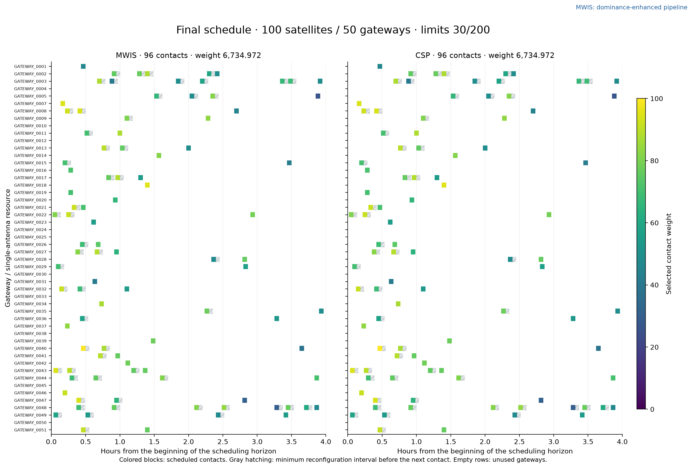

MWIS uses the dominance-enhanced pipeline. Matched final MWIS/CSP schedules for 100/50, terminal limits 30/200. Both panels use the same gateway order and frozen four-hour horizon. Contact colors share the 0–100 operational-weight scale. Required setup intervals are drawn only between successive selected contacts, excluding a trailing reservation after the last contact. Empty gateways remain visible. Equal objectives need not imply identical contact choices or timings. This is the simplified single-antenna, at-most-one-contact-per-satellite model.

[Vector PDF](13_schedule_gantt_s100_g50.pdf)

### 14_gateway_contacts_s100_g50

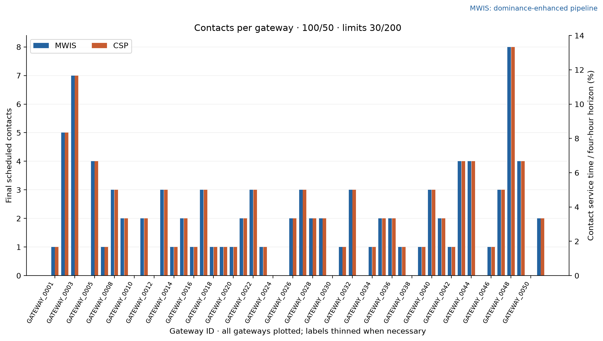

MWIS uses the dominance-enhanced pipeline. Final selected contacts per gateway for 100/50, limits 30/200. Zero-contact gateways remain included. Since every selected contact lasts four minutes and each station has one antenna, the right axis converts counts to service occupancy over the four-hour horizon. Occupancy excludes setup, visibility availability and idle time; low occupancy is constrained by the one-contact-per-satellite model and is not a measurement of real Starlink network efficiency. Contact counts, minutes, weight and occupancy for every gateway are exported in gateway_metrics.csv.

[Vector PDF](14_gateway_contacts_s100_g50.pdf)

### 13_schedule_gantt_baseline

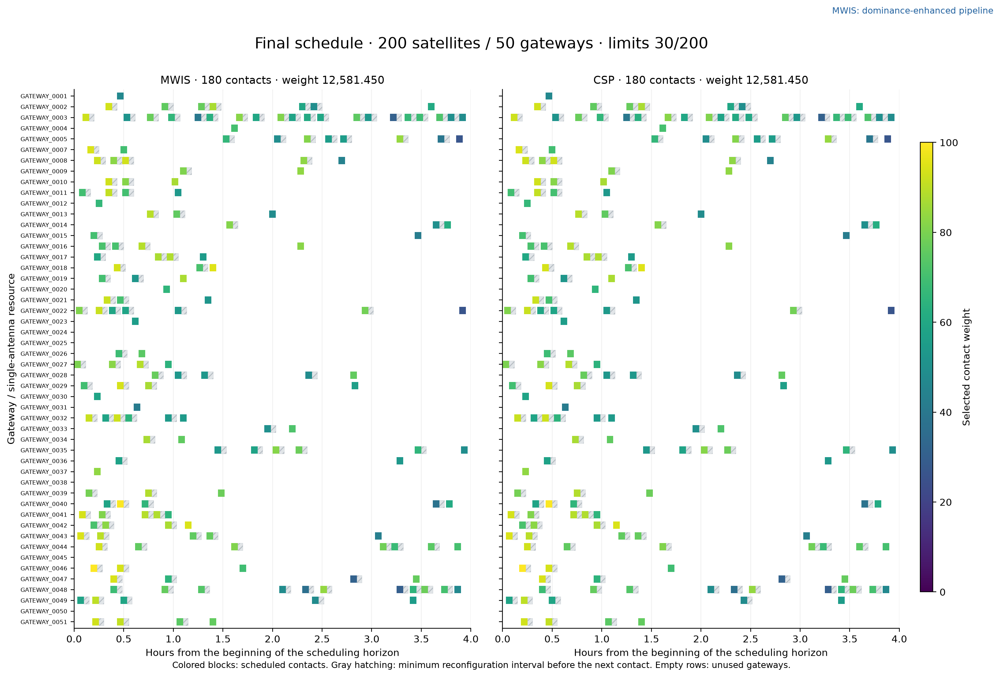

MWIS uses the dominance-enhanced pipeline. Matched final MWIS/CSP schedules for 200/50, terminal limits 30/200. Both panels use the same gateway order and frozen four-hour horizon. Contact colors share the 0–100 operational-weight scale. Required setup intervals are drawn only between successive selected contacts, excluding a trailing reservation after the last contact. Empty gateways remain visible. Equal objectives need not imply identical contact choices or timings. This is the simplified single-antenna, at-most-one-contact-per-satellite model.

[Vector PDF](13_schedule_gantt_baseline.pdf)

### 14_gateway_contacts_baseline


MWIS uses the dominance-enhanced pipeline. Final selected contacts per gateway for 200/50, limits 30/200. Zero-contact gateways remain included. Since every selected contact lasts four minutes and each station has one antenna, the right axis converts counts to service occupancy over the four-hour horizon. Occupancy excludes setup, visibility availability and idle time; low occupancy is constrained by the one-contact-per-satellite model and is not a measurement of real Starlink network efficiency. Contact counts, minutes, weight and occupancy for every gateway are exported in gateway_metrics.csv.

[Vector PDF](14_gateway_contacts_baseline.pdf)

### 13_schedule_gantt_s500_g50

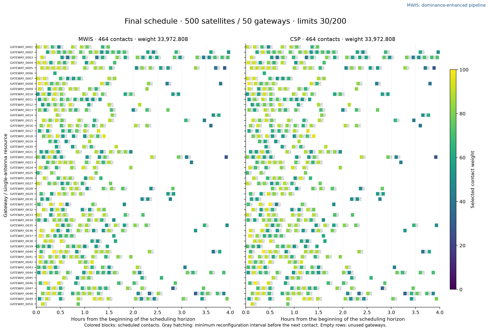

MWIS uses the dominance-enhanced pipeline. Matched final MWIS/CSP schedules for 500/50, terminal limits 30/200. Both panels use the same gateway order and frozen four-hour horizon. Contact colors share the 0–100 operational-weight scale. Required setup intervals are drawn only between successive selected contacts, excluding a trailing reservation after the last contact. Empty gateways remain visible. Equal objectives need not imply identical contact choices or timings. This is the simplified single-antenna, at-most-one-contact-per-satellite model.

[Vector PDF](13_schedule_gantt_s500_g50.pdf)

### 14_gateway_contacts_s500_g50

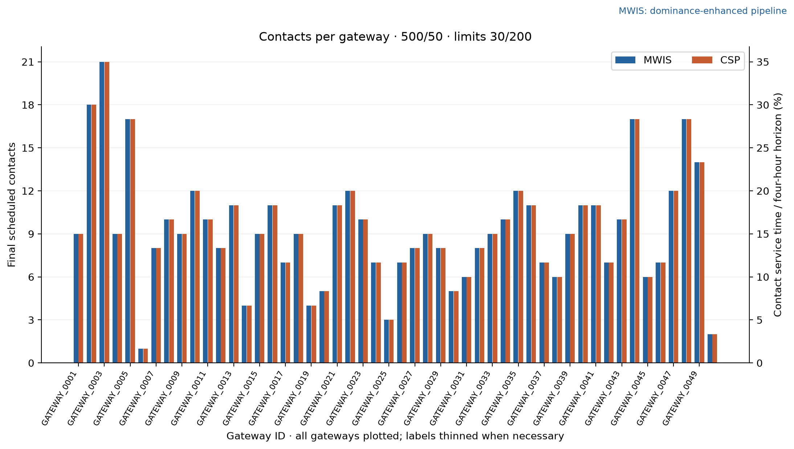

MWIS uses the dominance-enhanced pipeline. Final selected contacts per gateway for 500/50, limits 30/200. Zero-contact gateways remain included. Since every selected contact lasts four minutes and each station has one antenna, the right axis converts counts to service occupancy over the four-hour horizon. Occupancy excludes setup, visibility availability and idle time; low occupancy is constrained by the one-contact-per-satellite model and is not a measurement of real Starlink network efficiency. Contact counts, minutes, weight and occupancy for every gateway are exported in gateway_metrics.csv.

[Vector PDF](14_gateway_contacts_s500_g50.pdf)

### 13_schedule_gantt_s200_g25

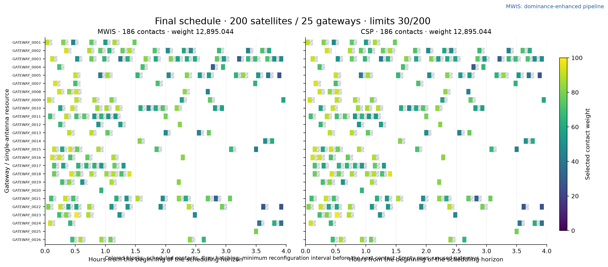

MWIS uses the dominance-enhanced pipeline. Matched final MWIS/CSP schedules for 200/25, terminal limits 30/200. Both panels use the same gateway order and frozen four-hour horizon. Contact colors share the 0–100 operational-weight scale. Required setup intervals are drawn only between successive selected contacts, excluding a trailing reservation after the last contact. Empty gateways remain visible. Equal objectives need not imply identical contact choices or timings. This is the simplified single-antenna, at-most-one-contact-per-satellite model.

[Vector PDF](13_schedule_gantt_s200_g25.pdf)

### 14_gateway_contacts_s200_g25

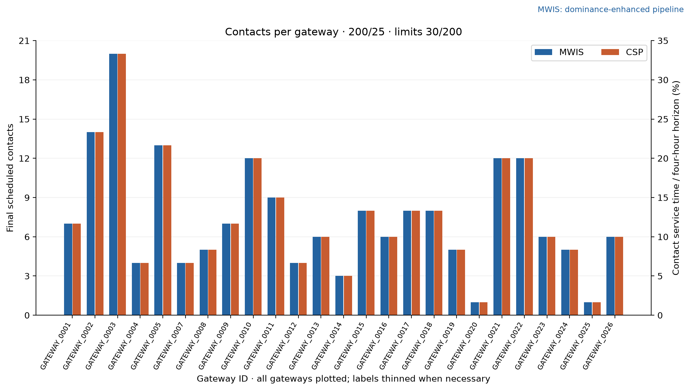

MWIS uses the dominance-enhanced pipeline. Final selected contacts per gateway for 200/25, limits 30/200. Zero-contact gateways remain included. Since every selected contact lasts four minutes and each station has one antenna, the right axis converts counts to service occupancy over the four-hour horizon. Occupancy excludes setup, visibility availability and idle time; low occupancy is constrained by the one-contact-per-satellite model and is not a measurement of real Starlink network efficiency. Contact counts, minutes, weight and occupancy for every gateway are exported in gateway_metrics.csv.

[Vector PDF](14_gateway_contacts_s200_g25.pdf)

### 13_schedule_gantt_s200_g100

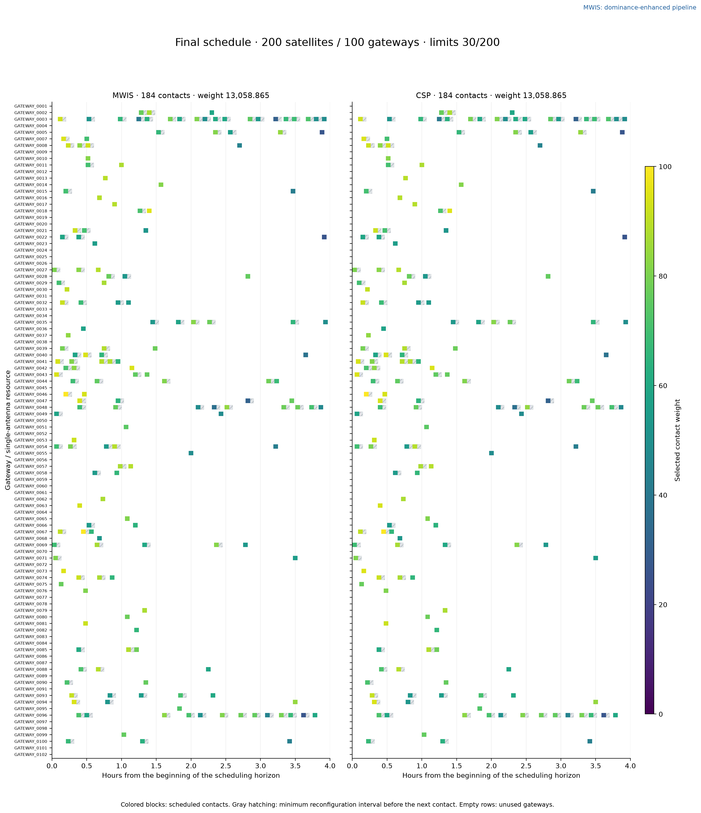

MWIS uses the dominance-enhanced pipeline. Matched final MWIS/CSP schedules for 200/100, terminal limits 30/200. Both panels use the same gateway order and frozen four-hour horizon. Contact colors share the 0–100 operational-weight scale. Required setup intervals are drawn only between successive selected contacts, excluding a trailing reservation after the last contact. Empty gateways remain visible. Equal objectives need not imply identical contact choices or timings. This is the simplified single-antenna, at-most-one-contact-per-satellite model.

[Vector PDF](13_schedule_gantt_s200_g100.pdf)

### 14_gateway_contacts_s200_g100

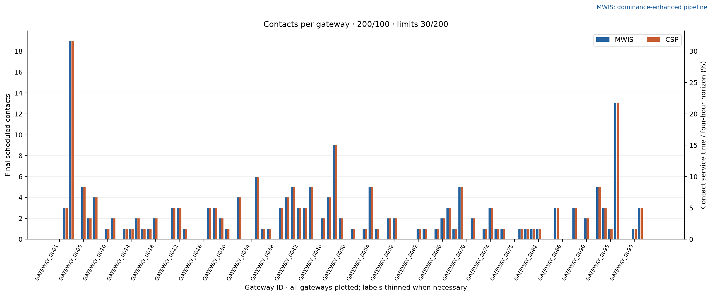

MWIS uses the dominance-enhanced pipeline. Final selected contacts per gateway for 200/100, limits 30/200. Zero-contact gateways remain included. Since every selected contact lasts four minutes and each station has one antenna, the right axis converts counts to service occupancy over the four-hour horizon. Occupancy excludes setup, visibility availability and idle time; low occupancy is constrained by the one-contact-per-satellite model and is not a measurement of real Starlink network efficiency. Contact counts, minutes, weight and occupancy for every gateway are exported in gateway_metrics.csv.

[Vector PDF](14_gateway_contacts_s200_g100.pdf)

### 13_schedule_gantt_n20_c100

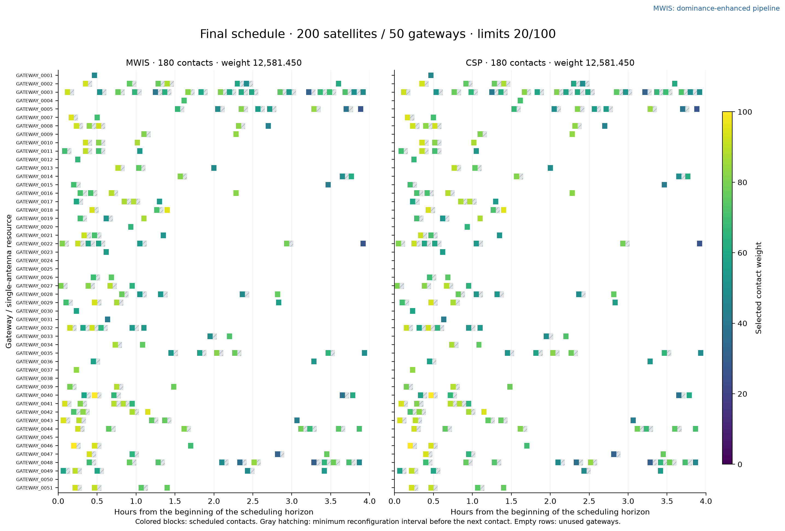

MWIS uses the dominance-enhanced pipeline. Matched final MWIS/CSP schedules for 200/50, terminal limits 20/100. Both panels use the same gateway order and frozen four-hour horizon. Contact colors share the 0–100 operational-weight scale. Required setup intervals are drawn only between successive selected contacts, excluding a trailing reservation after the last contact. Empty gateways remain visible. Equal objectives need not imply identical contact choices or timings. This is the simplified single-antenna, at-most-one-contact-per-satellite model.

[Vector PDF](13_schedule_gantt_n20_c100.pdf)

### 14_gateway_contacts_n20_c100

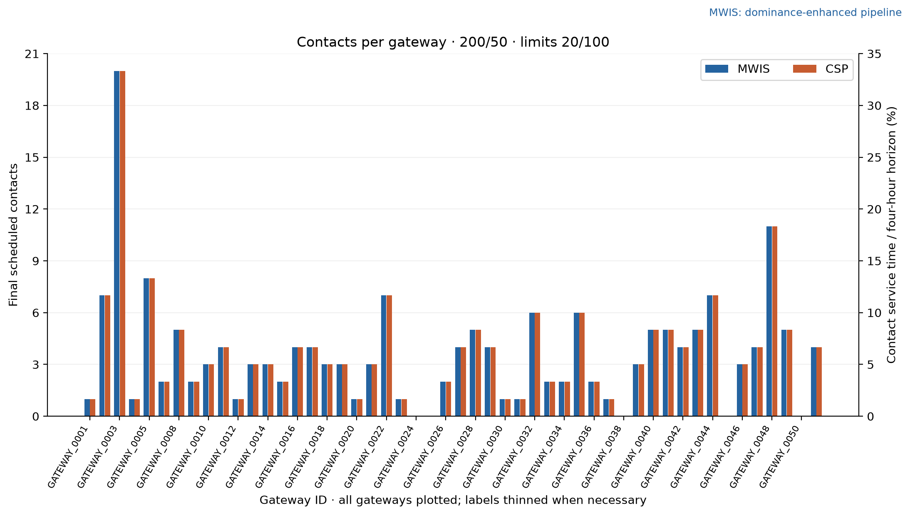

MWIS uses the dominance-enhanced pipeline. Final selected contacts per gateway for 200/50, limits 20/100. Zero-contact gateways remain included. Since every selected contact lasts four minutes and each station has one antenna, the right axis converts counts to service occupancy over the four-hour horizon. Occupancy excludes setup, visibility availability and idle time; low occupancy is constrained by the one-contact-per-satellite model and is not a measurement of real Starlink network efficiency. Contact counts, minutes, weight and occupancy for every gateway are exported in gateway_metrics.csv.

[Vector PDF](14_gateway_contacts_n20_c100.pdf)

### 13_schedule_gantt_n50_c350


MWIS uses the dominance-enhanced pipeline. Matched final MWIS/CSP schedules for 200/50, terminal limits 50/350. Both panels use the same gateway order and frozen four-hour horizon. Contact colors share the 0–100 operational-weight scale. Required setup intervals are drawn only between successive selected contacts, excluding a trailing reservation after the last contact. Empty gateways remain visible. Equal objectives need not imply identical contact choices or timings. This is the simplified single-antenna, at-most-one-contact-per-satellite model.

[Vector PDF](13_schedule_gantt_n50_c350.pdf)

### 14_gateway_contacts_n50_c350

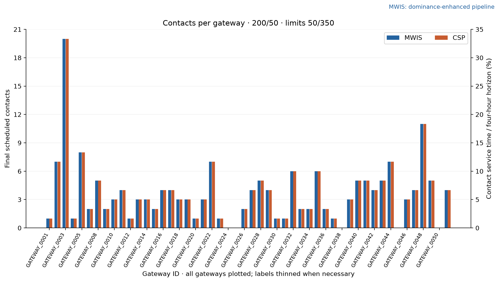

MWIS uses the dominance-enhanced pipeline. Final selected contacts per gateway for 200/50, limits 50/350. Zero-contact gateways remain included. Since every selected contact lasts four minutes and each station has one antenna, the right axis converts counts to service occupancy over the four-hour horizon. Occupancy excludes setup, visibility availability and idle time; low occupancy is constrained by the one-contact-per-satellite model and is not a measurement of real Starlink network efficiency. Contact counts, minutes, weight and occupancy for every gateway are exported in gateway_metrics.csv.

[Vector PDF](14_gateway_contacts_n50_c350.pdf)
